# 《借聲》真人角色與圖片敘事製作規範

2026-11-20。依當日新版 `01_完整劇情與章節設計.md` 及 `src/story/` 製作。02、03 的舊版設定不作本批依據。

## 已確認方向

- 使用者確認五位成年朋友 **38～40 歲**，各有特色、台灣生活感、真人照片質感。不能以疲態代替年齡，也不能全部畫成四五十歲的滄桑面孔。
- 小雨 **7 歲、完整自然牙齒**。不使用缺牙、成人化、性感化或腐爛外貌。
- 線索圖以 **夜晚、陰森、真實、老舊** 為主。物件在手電筒／微弱殘燭光裡可辨識，背景留暗；不用白底商品照或明亮日景。
- 角色三視圖採中性棚光供建模；遊戲劇情插圖另用場景照明。同一角色的臉、衣物、左右側與鞋款持續對齊。
- 使用內建 image_gen 逐張製作，每個最終圖片旁有同名 JSON，記錄完整提示詞、參考圖片及用途。PNG 保留為原稿，遊戲可用 WebP 另外輸出。

## 年齡與年代

童年事件1998年、現在2026年，相隔28年。下表是本次美術定稿的明確工作年齡；五人38～40的區間由使用者確認，區間內分配及未被原劇本指定的父母／郭師父／管理員年齡屬本批美術補充，不冒充原文事實。未設定生日，表內以年差對照。

| 人物 | 1998 | 2026／出場樣貌 | 區別 |
|---|---:|---|---|
| 陳以安 | 11 | 39 | 瘦長臉、芥黃內搭、右掌舊疤 |
| 張明哲 | 12 | 40 | 方下顎、微捲髮、器材袋與工作靴 |
| 許志豪 | 11 | 39 | 厚實體態、平頭、水電背心與藍白拖 |
| 吳柏翰 | 10 | 38 | 瘦高、細框眼鏡、粉筆、踩扁後跟球鞋 |
| 周佩珊 | 10 | 38 | 短方臉、單側酒窩、短髮與綠外套 |
| 林小雨 | 7 | 維持7歲 | 細花白裙、紅布鞋、紅布兔 |
| 林美蘭 | 28 | 女影保留1999年29歲樣貌 | 左腕紅線、米白素衣；與女影同臉 |
| 林正雄 | 31 | 只用生前影像 | 招風耳、自然捲、青綠POLO |
| 郭建成 | 18 | 46（原劇本已明定） | 紙紮圍裙、婚戒、鬢角早白 |
| 郭永順 | 52 | 主要出現於1998記憶 | 細圓眼鏡、墨漬半圍裙 |
| 公寓管理員 | 不使用回憶版 | 61 | 掛繩眼鏡、腰間鑰匙、舊制服 |

1998衣物尚未經歷28年腐朽。2026遺物才有相應風化。年齡由人物表決定，光線和表情不改變身份。

## 角色參考圖

### 陳以安｜2026・39歲

主角；當年扣門與放開鑰匙。長窄臉、左眉尾下小痣；芥黃內搭；右掌鑰匙齒形舊疤。

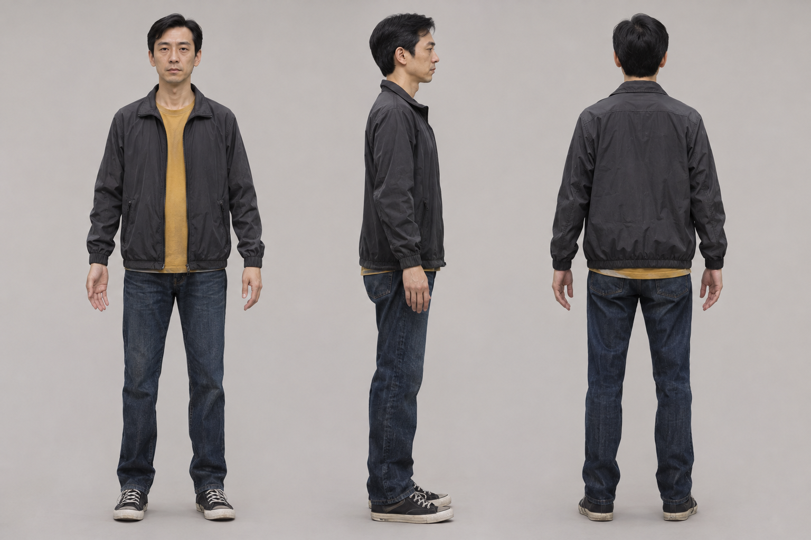

原稿：`art-direction/visual-bible-20261120/characters/chen-yian-2026-v2.png`。

### 張明哲／阿哲｜2026・40歲

器材清點者；當年提議先扣門。方下顎、右眉斷口、微鷹鼻；藍色器材標籤、棕色工作靴。

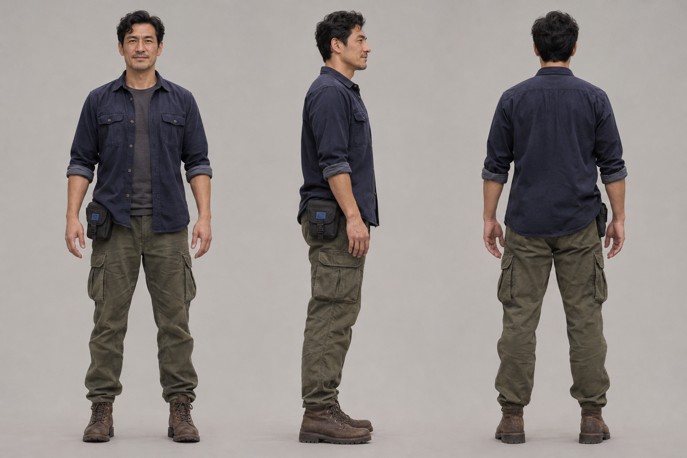

原稿：`art-direction/visual-bible-20261120/characters/zhang-mingzhe-2026-v2.png`。

### 許志豪｜2026・39歲

水電工；當年藏起小雨的鞋。圓寬臉、平頭、厚實前臂；灰綠工作背心、藍白拖。

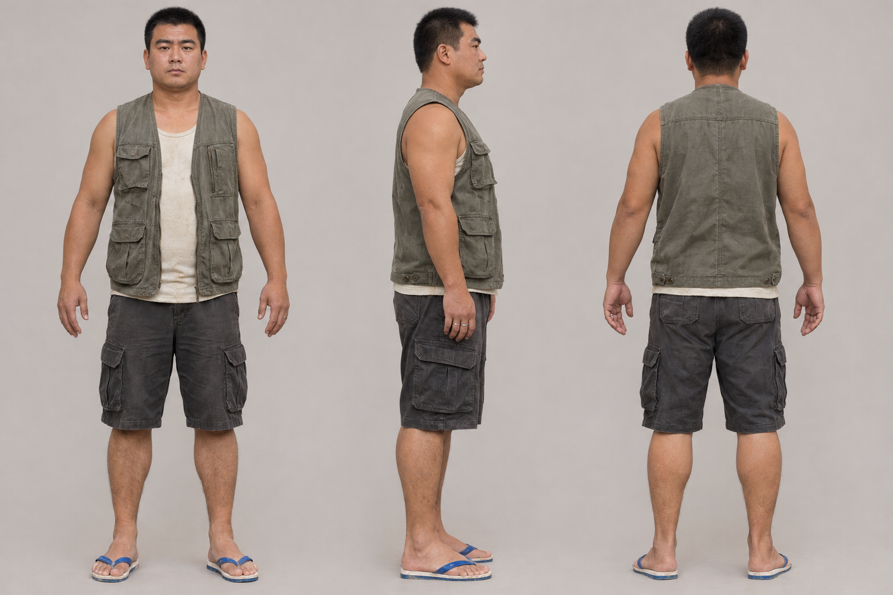

原稿：`art-direction/visual-bible-20261120/characters/xu-zhihao-2026-v2.png`。

### 吳柏翰｜2026・38歲

國小三年二班老師；告訴小雨後殿能聽見爸爸。長臉、細框矩形眼鏡、右嘴角小痣；淡藍格紋襯衫、踩扁後跟球鞋。

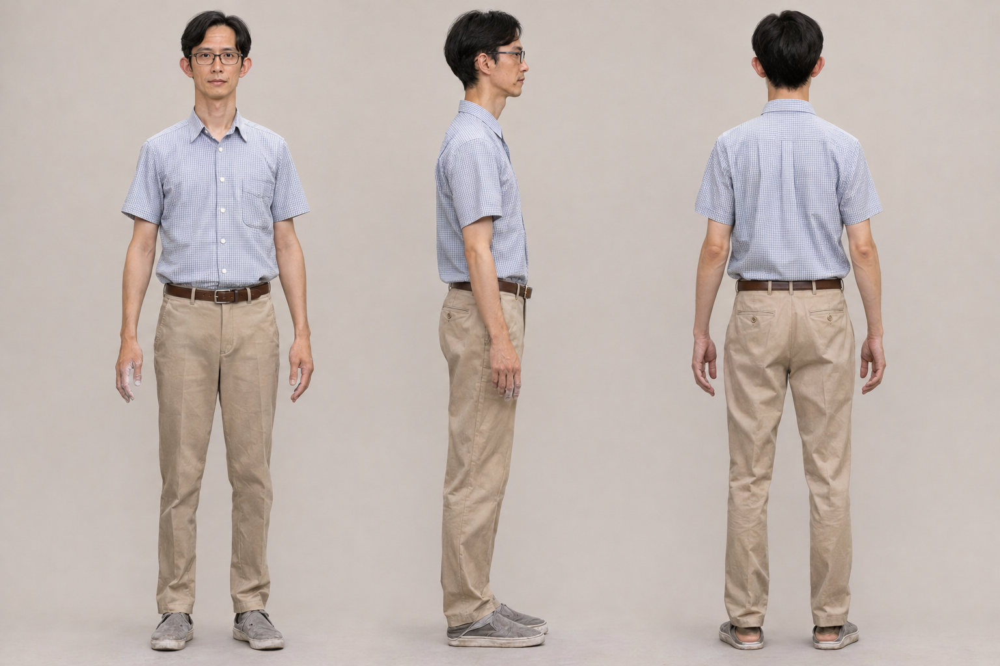

原稿：`art-direction/visual-bible-20261120/characters/wu-bohan-2026-v2.png`。

### 周佩珊｜2026・38歲

山外見證者；當年代喊第六聲有。短方臉、左臉單酒窩、下巴短髮；鼠尾草綠外套、帆布袋。

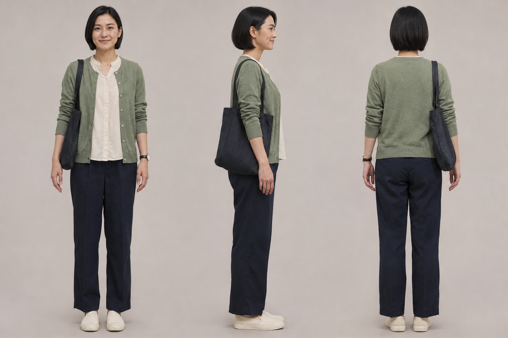

原稿：`art-direction/visual-bible-20261120/characters/zhou-peishan-2026-v2.png`。

### 林小雨｜1998・7歲

第六個孩子；布兔主人。七歲、短圓臉、寬眼距、整齊自然牙齒；細花白棉裙、紅布鞋。

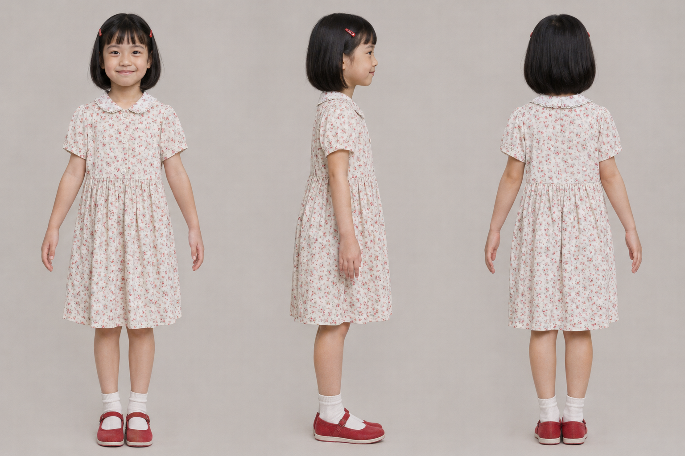

原稿：`art-direction/visual-bible-20261120/characters/lin-xiaoyu-1998-v2.png`。

### 林美蘭｜1998・28歲

小雨母親；借聲問者。28歲年輕母親；短心形臉、右頰淡雀斑；米白素衣、左腕紅線。

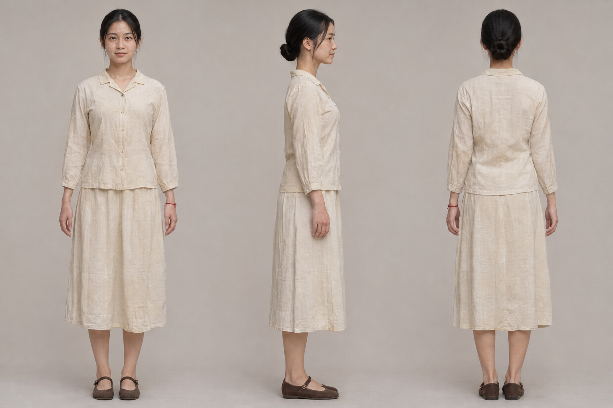

原稿：`art-direction/visual-bible-20261120/characters/lin-meilan-1998-v2.png`。

### 郭建成｜2026・46歲

紙紮行後人；代管廟務。梯形寬臉、鬢角早白、鼻梁舊小疤；靛藍漿糊圍裙、左手金婚戒。

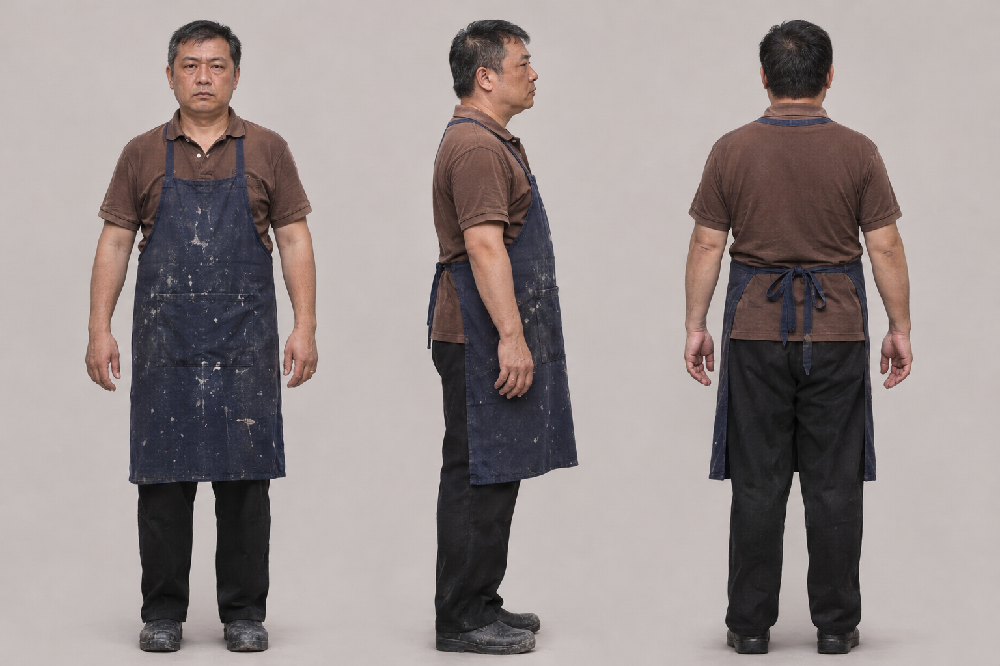

原稿：`art-direction/visual-bible-20261120/characters/guo-jiancheng-2026-v2.png`。

### 郭永順／郭師父｜1998・52歲

郭建成父親；1998 借聲主事。瘦矮、顴骨明顯、細圓眼鏡；灰藍短襯衫、墨漬半圍裙。

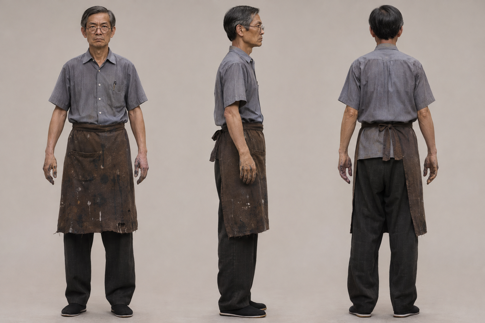

原稿：`art-direction/visual-bible-20261120/characters/guo-yongshun-1998.png`。

### 林正雄｜1998・31歲

小雨父親；春天過世，只以生前影像出現。31歲生前樣貌；招風耳、寬笑容、自然捲；青綠 POLO。

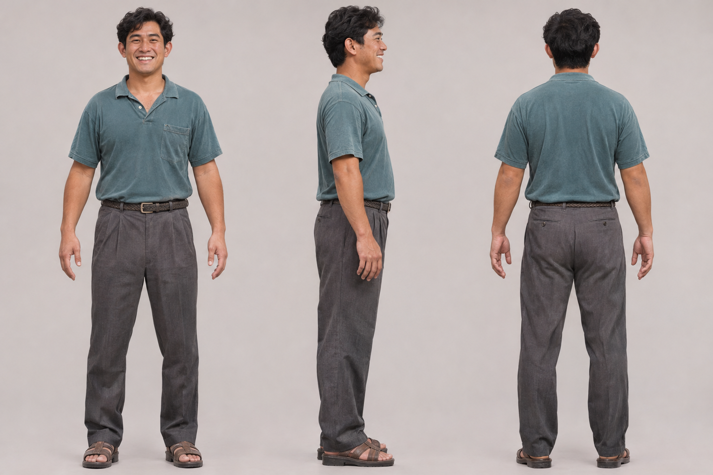

原稿：`art-direction/visual-bible-20261120/characters/lin-zhengxiong-1998.png`。

### 公寓管理員｜2026・61歲

住處聲音來源；下落保持留白。61歲暫定美術設定；圓臉銀髮、掛繩老花眼鏡、腰間鑰匙。

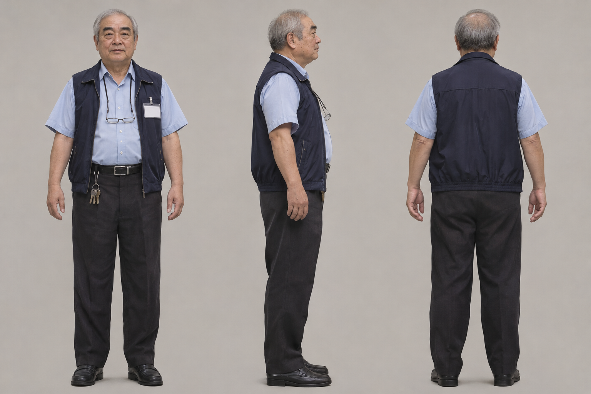

原稿：`art-direction/visual-bible-20261120/characters/building-caretaker-2026.png`。

### 陳以安（童年）｜1998・11歲

1998 回憶版本。芥黃色短袖、洗白牛仔短褲、帆布鞋

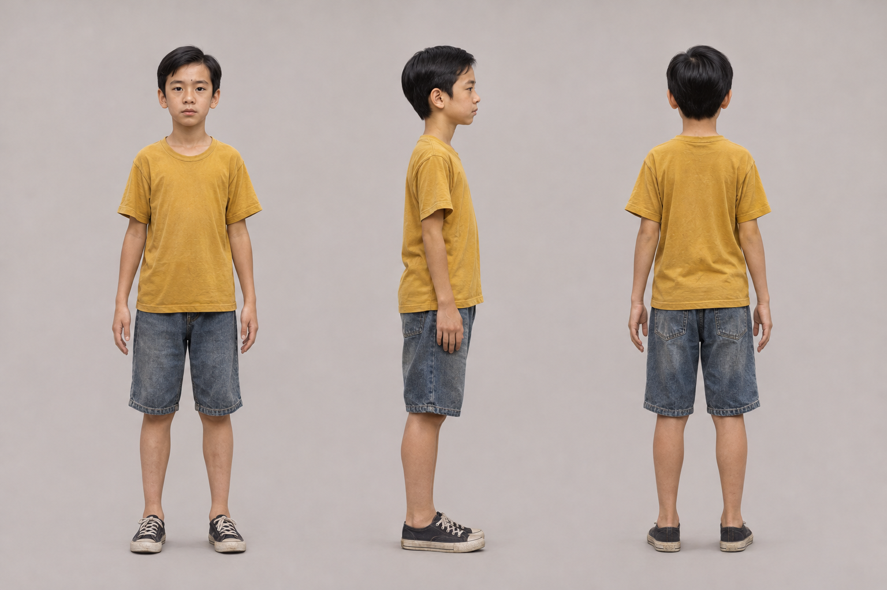

原稿：`art-direction/visual-bible-20261120/characters/chen-yian-1998.png`。

### 張明哲／阿哲（童年）｜1998・12歲

1998 回憶版本。灰白運動背心、深藍短褲

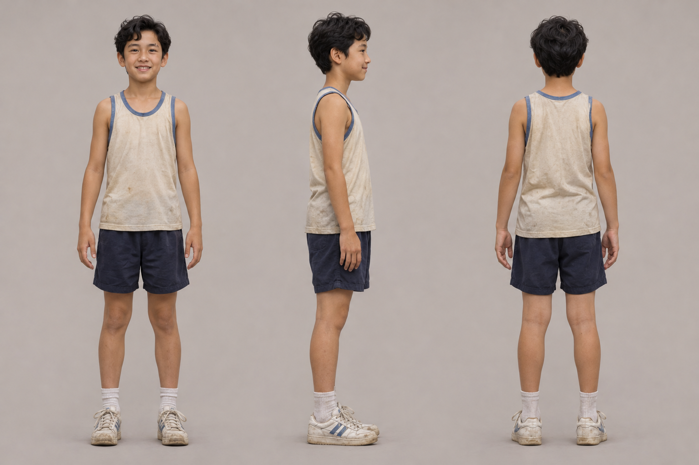

原稿：`art-direction/visual-bible-20261120/characters/zhang-mingzhe-1998.png`。

### 許志豪（童年）｜1998・11歲

1998 回憶版本。藍灰橫條短袖、卡其短褲、藍白拖

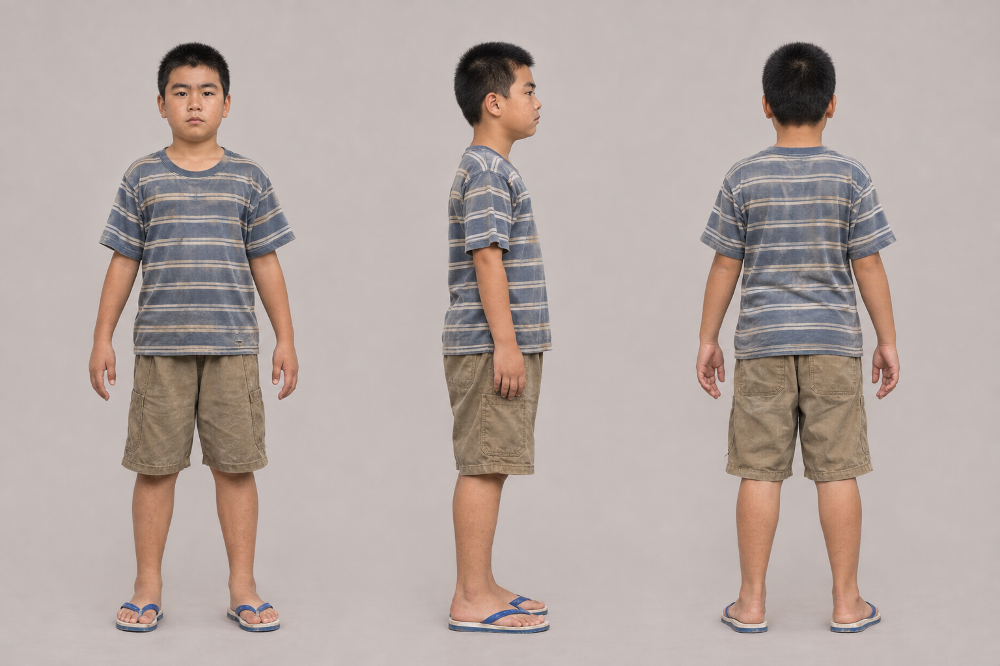

原稿：`art-direction/visual-bible-20261120/characters/xu-zhihao-1998.png`。

### 吳柏翰（童年）｜1998・10歲

1998 回憶版本。磚紅白橫條 POLO、灰短褲、球鞋

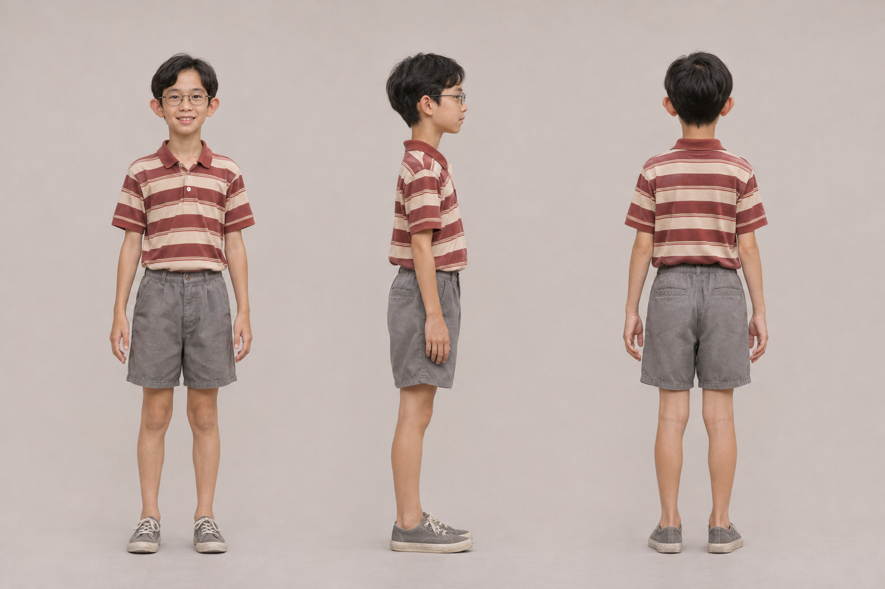

原稿：`art-direction/visual-bible-20261120/characters/wu-bohan-1998.png`。

### 周佩珊（童年）｜1998・10歲

1998 回憶版本。白短袖、丹寧吊帶裙、白布鞋

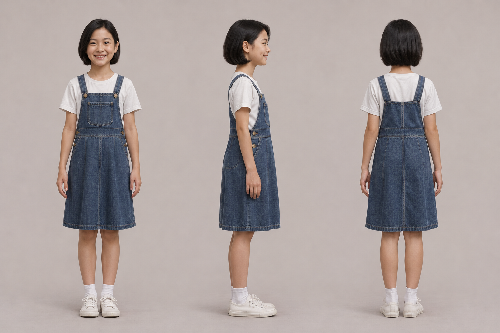

原稿：`art-direction/visual-bible-20261120/characters/zhou-peishan-1998.png`。

### 借聲者／林美蘭的外貌｜1999・29歲

同一張母親的臉；不能變成成年小雨。同美蘭臉型；散落濕長髮、米白素衣、左腕紅線、赤腳；異常來自姿態。

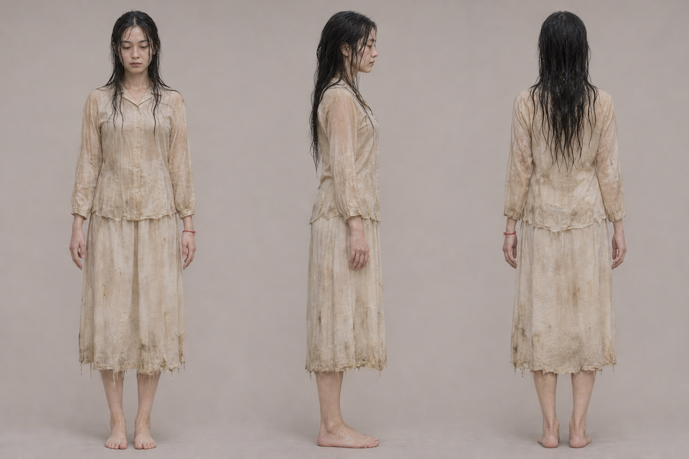

原稿：`art-direction/visual-bible-20261120/characters/borrowed-meilan-1999.png`。

### 郭建成（學徒）｜1998・18歲

郭師父身旁的年輕學徒。郭建成年輕臉型；純黑短髮、白汗衫、短靛藍圍裙，無婚戒。

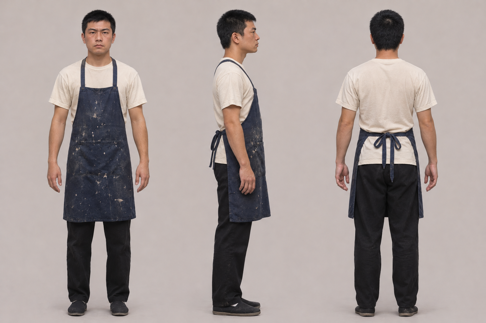

原稿：`art-direction/visual-bible-20261120/characters/guo-jiancheng-1998.png`。

## 建模與連續性

1. 圖片是外形參考，不是3D模型或可量測的攝影測量。建模前以身高表、正面比例、側面輪廓交叉校正；三張視角的小配件差異以文字人物表為準。
2. 以安的燙疤只在右掌，1998起火前沒有；郭建成婚戒在左無名指，18歲版沒有。林美蘭紅線在左腕，兔子補的是兔子自身左耳。
3. 女影使用美蘭的臉與身形，不長成小雨；姿勢、濕髮、布料、光線製造異常，保留真結局能辨認出母親的可能。
4. 三個朋友並未在新劇本中被宣告死亡；結局C能救出。他們的恐怖圖用受困、蒙眼與不合常理的姿態，不能畫成斷頭屍體。
5. 郭建成手部線索保留紙／皮之間的曖昧，不用圖片斷言他的死因或下落。
6. 只被提及、無確定外貌的背景人物（以安母親、柏翰太太、阿土伯父子及其餘村民）不混入主要角色名單；未擅自增加新姓名或關鍵劇情。
7. 蒙眼紅布必須寬且完全不透光，上緣越過眉毛，下緣蓋過下眼瞼；鼻樑、內外眼角與兩側均不露縫。可破的是垂尾，遮眼位置不可穿孔或透出眼睛。
8. 站立、坐姿與救援畫面都要核對接地：鞋底、椅腳、擔架輪子不能穿入地板或階梯。救援定稿採階梯前的平坦平台，四輪與三位站立者的鞋子完整露出。

## 圖片與文字如何合作

- 線索閱讀：上方或左側一張物件圖，下方／右側維持現有證物全文；圖片給材質、位置和不對勁，文字補精確內容。
- 劇情圖片：每個關鍵節點一張畫面，配1～3句對話或旁白；玩家手動繼續，不自動倒數，不製作影片，不以大量同角度圖片代替影片。
- 前期不直接展示小雨名字、美蘭真身或三個朋友的下落。圖冊含劇透；遊戲只在對應取得／事件完成時顯示。
- 生成圖中的字屬物件表面。玩法依據仍以可選取、可縮放的繁體中文正文為準，不能把生成字的小瑕疵當成謎題。
- 童年合照與溫柔回憶可保持當年的自然光；2026調查線索採夜景。結局C的黎明是有意義的光線變化。

詳見同目錄《08_線索圖與圖片劇情腳本.md》及 `art-direction/visual-bible-20261120/index.html` 圖冊。本文件不重寫遊戲事件與結局判定。

