# 《說好不說》線索圖片與圖片劇情腳本

2026-11-20｜依新版主劇本。本文含完整劇透，供製作使用。

## 視覺與顯示規則

線索一律以夜晚、真實、陰森、老舊為主。背景留暗，手電筒、殘燭或物件本身微光只照出需要閱讀的區域。黑暗不能遮掉解謎物件；用潮痕、鏽蝕、錯置與沒有人的痕跡製造恐懼。

住處仍是有人居住的台灣老公寓；山村、紙紮行與廟內才有較重的廢棄感。人物三視圖用中性光方便建模。真結局的黎明屬劇情收束，不套用夜間線索限制。

圖片與文字資產已分開保存。本文的 trigger 是程式掛接建議；本批不以美術圖取代現有場景，也不宣稱已自動接入所有事件。遊戲讀圖應依 BASE_URL 載入 `assets/story/visual-v2/`，不在開始時下載所有原稿。使用 WebP，PNG 留作美術母檔。

- 閱讀線索：先顯示物件圖與短句，保留原有證物全文、收藏及重讀功能。
- 關鍵情節：一張靜幀搭配下列對話／旁白，玩家手動繼續；不生成影片，不加自動跳頁倒數。
- 重要文字保持可選取的 HTML 正文；圖中字跡不能作為唯一解謎依據。
- 名字、美蘭真身、暗道三人和各結局圖片，只在對應事件已發生時解鎖。圖冊含全部素材，不可直接當作玩家的初始收藏清單。
- 同一角色引用07的人物圖；童年與成年服裝不同，不能用成人臉直接縮小。

## 線索物件圖

### 01｜停在六的計數器

- 章節：第二章
- 對應取得點：`EVIDENCE.diary`
- 資產ID：`evidence-diary`
- 遊戲圖片：`assets/story/visual-v2/evidence-diary.webp`

> 數字是六。留下記號的，卻只有五個。

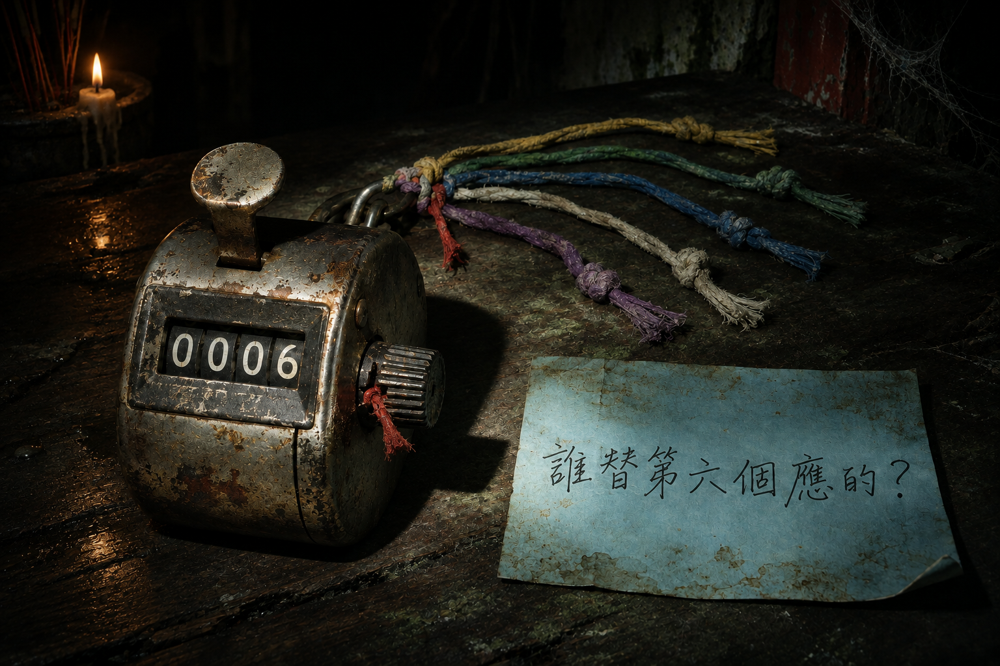

### 02｜從外側扣上的門閂

- 章節：第二章
- 對應取得點：`EVIDENCE.newspaper`
- 資產ID：`evidence-newspaper`
- 遊戲圖片：`assets/story/visual-v2/evidence-newspaper.webp`

> 閂舌還在扣環裡。火卻是從另一面燒過來的。

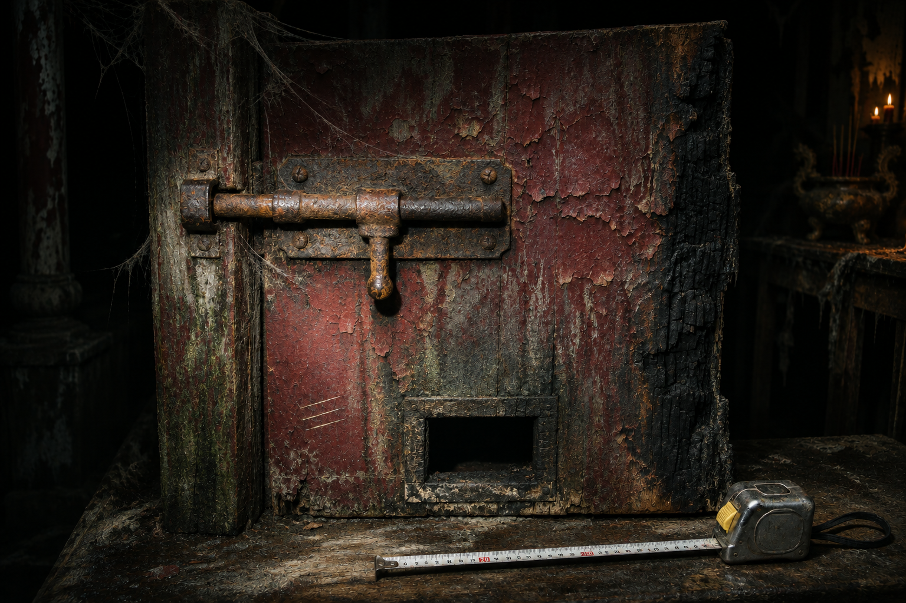

### 03｜被接回去的錄音

- 章節：第二章
- 對應取得點：`EVIDENCE.tape`
- 資產ID：`evidence-tape`
- 遊戲圖片：`assets/story/visual-v2/evidence-tape.webp`

> 我按了停止。身後卻有人把那半句接完。

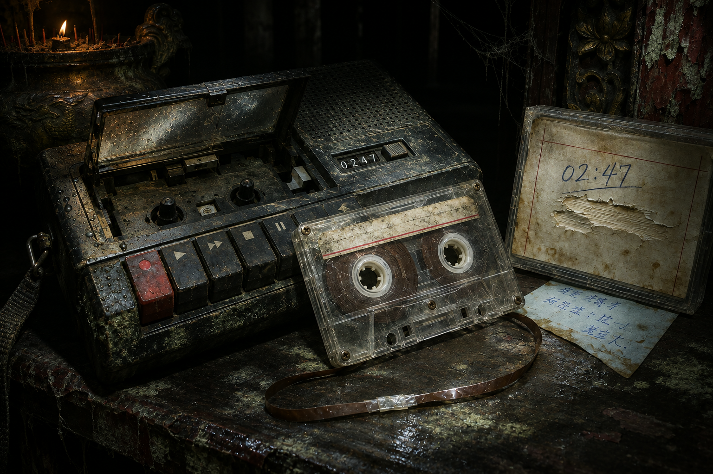

### 04｜第六張椅子

- 章節：第三章
- 對應取得點：`EVIDENCE.stage`
- 資產ID：`evidence-stage`
- 遊戲圖片：`assets/story/visual-v2/evidence-stage.webp`

> 第六聲「有」，不是從第六張椅子傳來的。

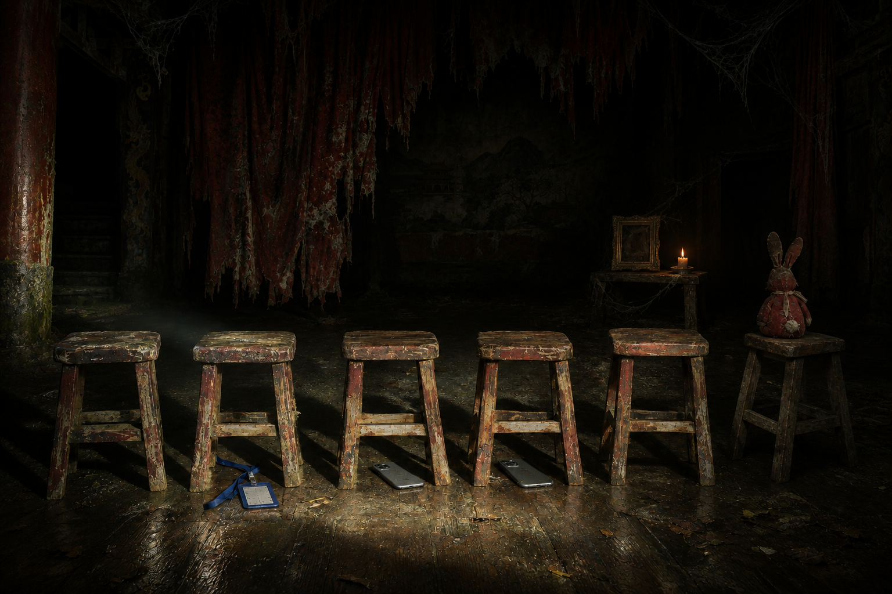

### 05｜被磨平的送行盤

- 章節：第二章／真結局
- 對應取得點：`EVIDENCE.ritual`
- 資產ID：`evidence-ritual`
- 遊戲圖片：`assets/story/visual-v2/evidence-ritual.webp`

> 先記其名，再歸其物，末留其事。

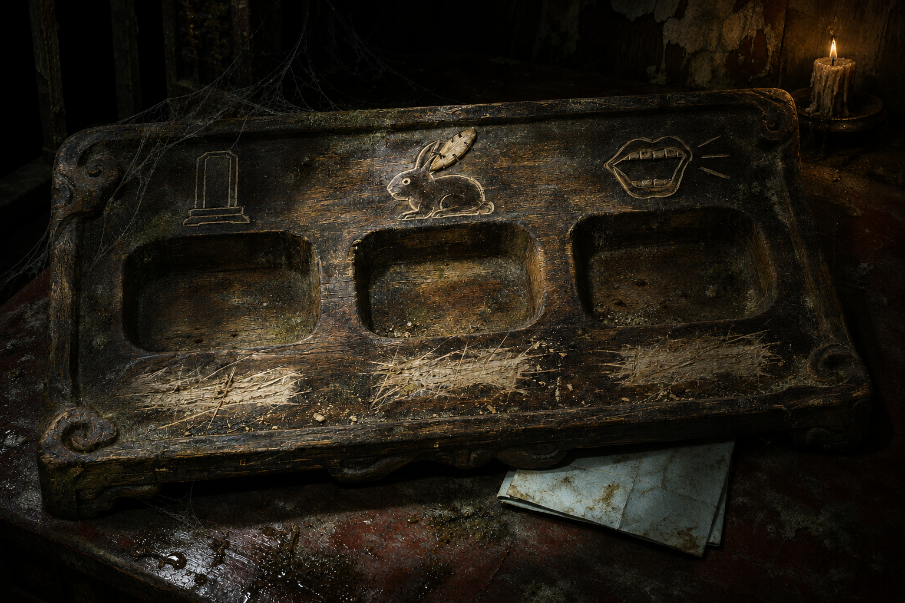

### 06｜阿哲留下的手機

- 章節：第四章
- 對應取得點：`EVIDENCE.death`
- 資產ID：`evidence-death`
- 遊戲圖片：`assets/story/visual-v2/evidence-death.webp`

> 打給我的那一段，兩個星期前就錄好了。

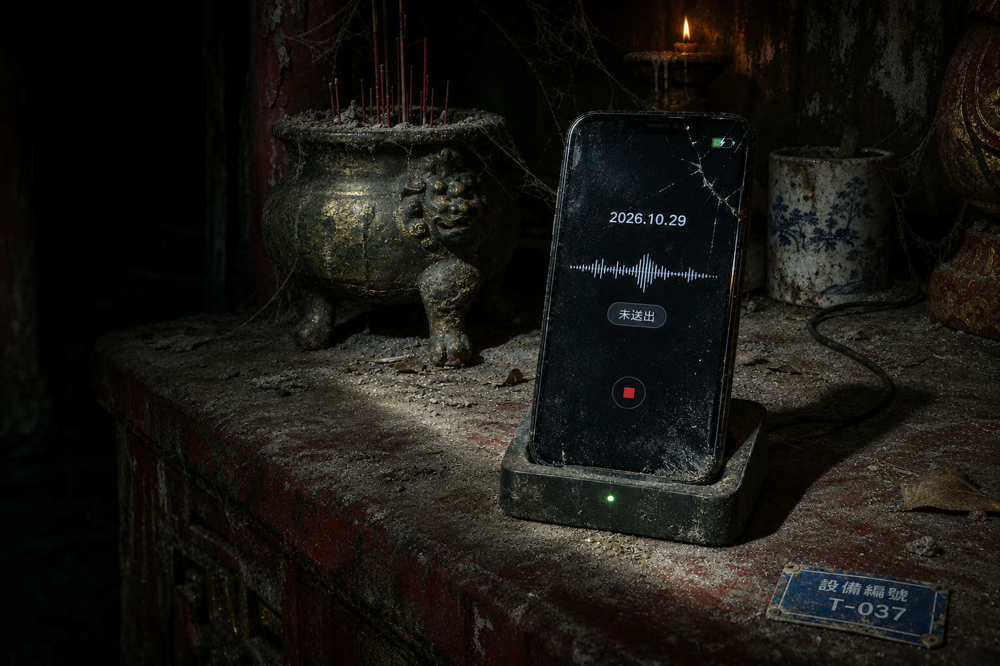

### 07｜門框上的六道身高

- 章節：第四章
- 對應取得點：`EVIDENCE.births`
- 資產ID：`evidence-births`
- 遊戲圖片：`assets/story/visual-v2/evidence-births.webp`

> 最矮的那道，不是沒有名字。是被蓋住了。

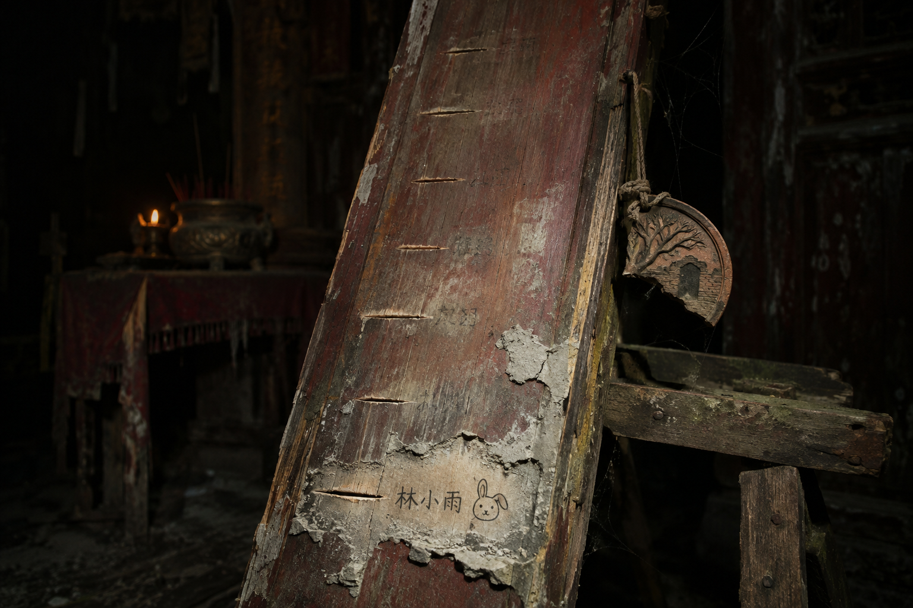

### 08｜補過左耳的布兔

- 章節：第四章
- 對應取得點：`EVIDENCE.relic`
- 資產ID：`evidence-relic`
- 遊戲圖片：`assets/story/visual-v2/evidence-relic.webp`

> 耳朵媽媽補好了。她還在等我們來找她。

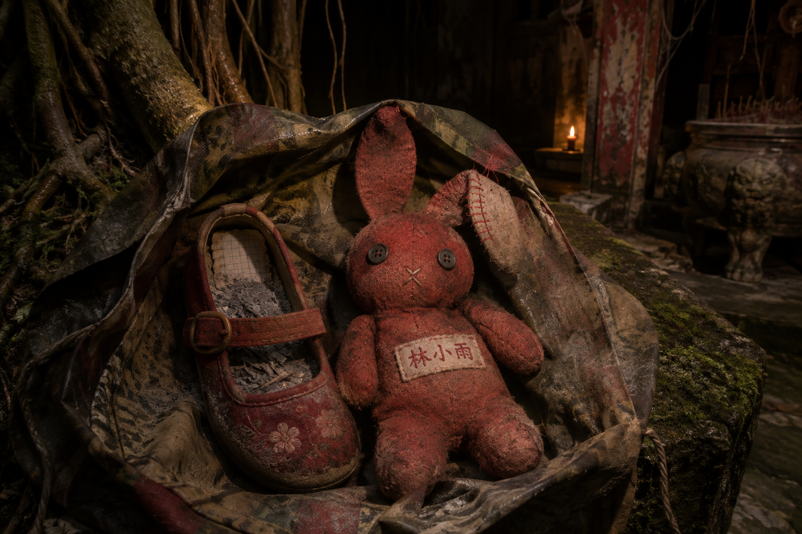

### 09｜五個重疊的手印

- 章節：第四章
- 對應取得點：`EVIDENCE.names`
- 資產ID：`evidence-names`
- 遊戲圖片：`assets/story/visual-v2/evidence-names.webp`

> 我以為有人塗掉了她。少的那張，卻在我口袋裡。

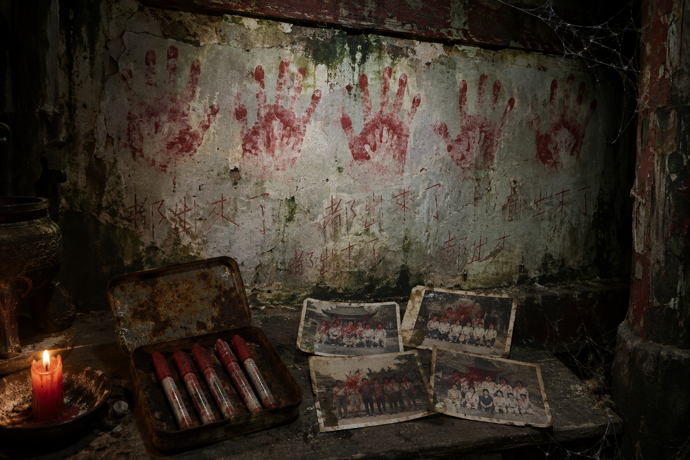

### 10｜掌心裡的齒痕

- 章節：第四章
- 對應取得點：`EVIDENCE.confession`
- 資產ID：`evidence-confession`
- 遊戲圖片：`assets/story/visual-v2/evidence-confession.webp`

> 缺角壓上的地方，正好就是那道舊疤。

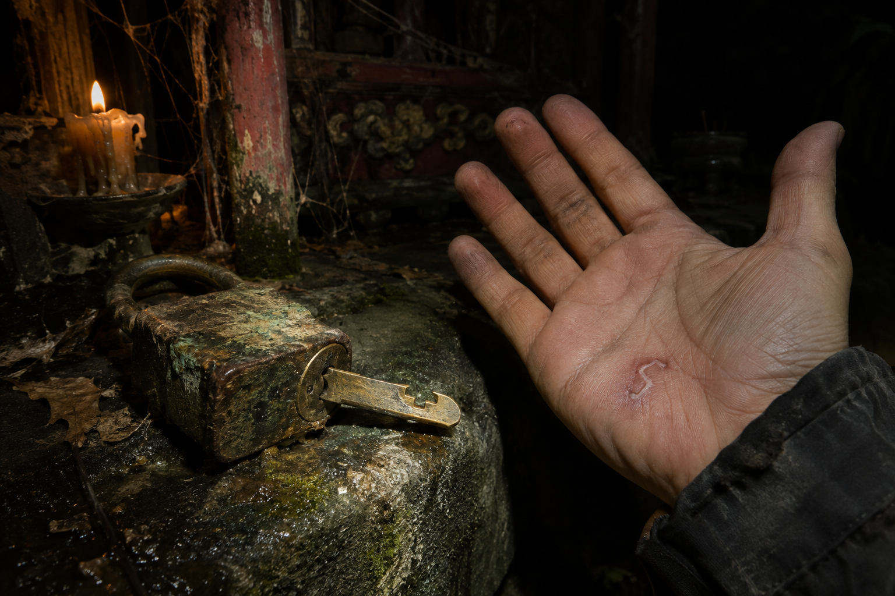

### 11｜阿哲的清點日誌

- 章節：第二章
- 對應取得點：`NOTES.log`
- 資產ID：`note-log`
- 遊戲圖片：`assets/story/visual-v2/note-log.webp`

> 他不是來清點帶子。他是來找那一分鐘。

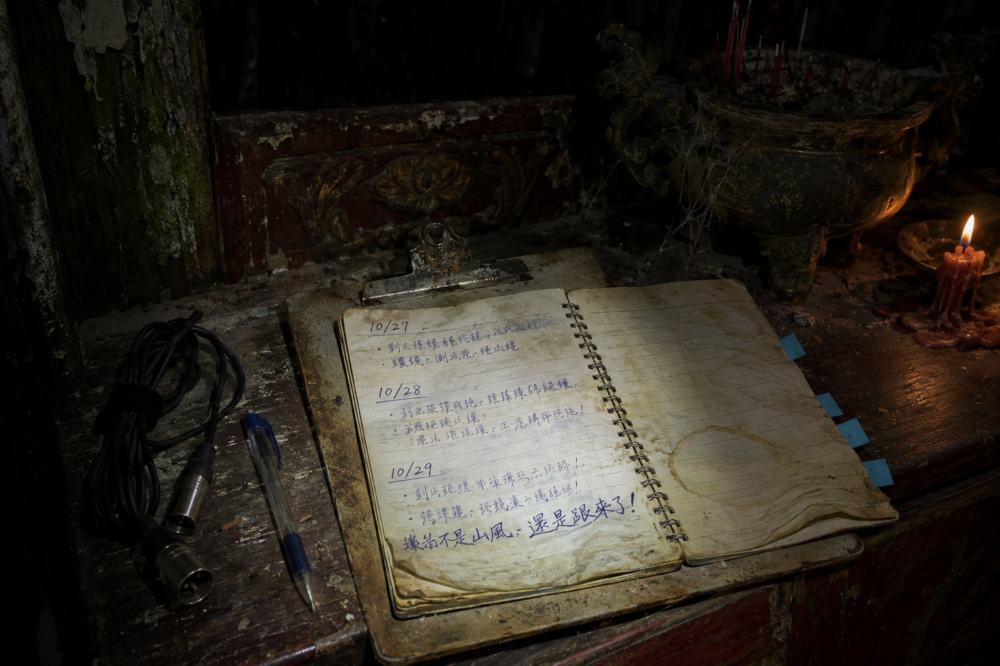

### 12｜問者的素衣

- 章節：第二章
- 對應取得點：`NOTES.robe`
- 資產ID：`note-robe`
- 遊戲圖片：`assets/story/visual-v2/note-robe.webp`

> 剪刀沒有用過。她那晚沒有問完。

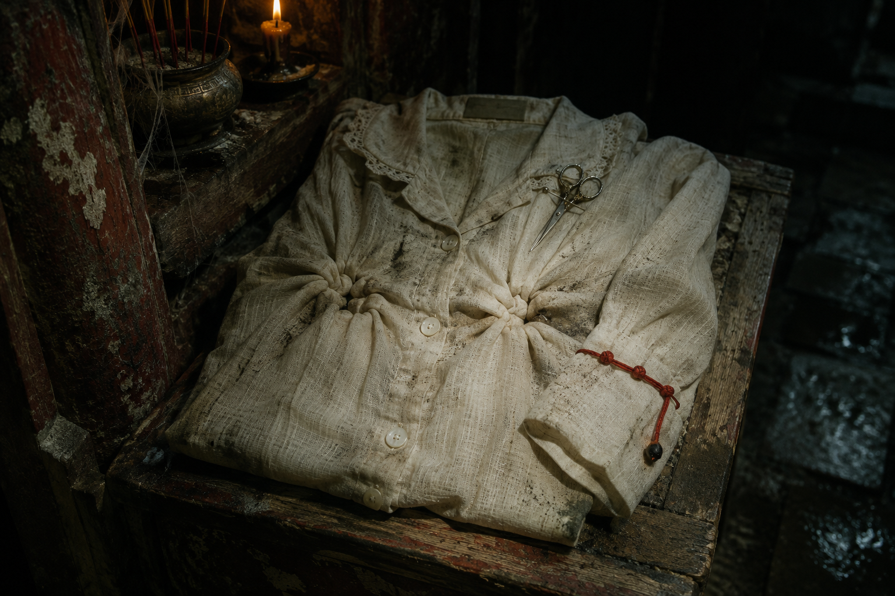

### 13｜郭師父的規矩簿

- 章節：第二章
- 對應取得點：`NOTES.rulebook`
- 資產ID：`note-rulebook`
- 遊戲圖片：`assets/story/visual-v2/note-rulebook.webp`

> 規矩替他們省掉了一件事：繼續聽她說話。

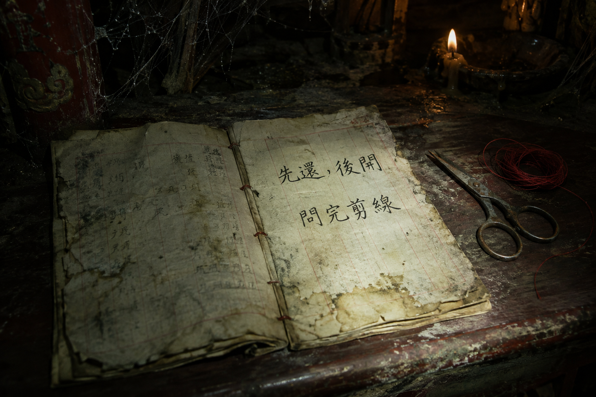

### 14｜還亮著的手電筒

- 章節：第二章
- 對應取得點：`NOTES.flashlight`
- 資產ID：`note-flashlight`
- 遊戲圖片：`assets/story/visual-v2/note-flashlight.webp`

> 他把光留在這裡，自己摸黑走了。

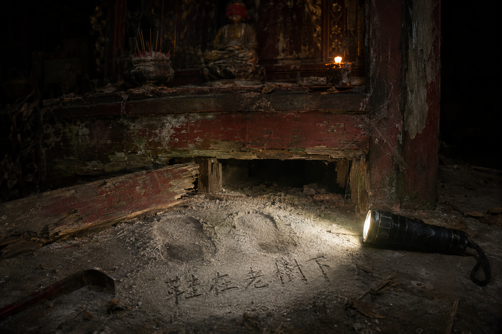

### 15｜柱子上的粉筆字

- 章節：第三章
- 對應取得點：`NOTES.chalk`
- 資產ID：`note-chalk`
- 遊戲圖片：`assets/story/visual-v2/note-chalk.webp`

> 他終於改口了。可是被叫了才答，仍然是應。

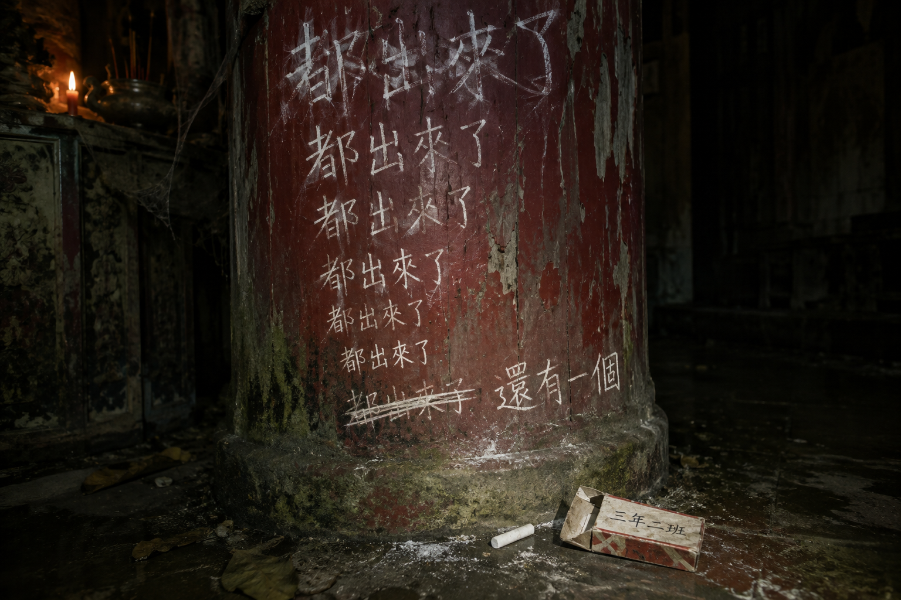

### 16｜翻過去的木牌

- 章節：第四章
- 對應取得點：`NOTES.tablet`
- 資產ID：`note-tablet`
- 遊戲圖片：`assets/story/visual-v2/note-tablet.webp`

> 這次妳叫，媽媽就應。

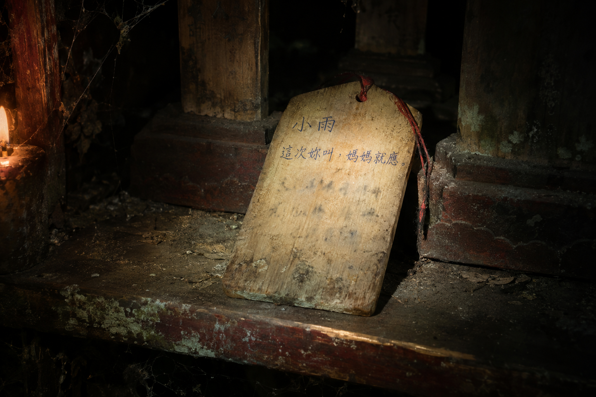

### 17｜阿哲的地鋪

- 章節：第四章
- 對應取得點：`NOTES.camp`
- 資產ID：`note-camp`
- 遊戲圖片：`assets/story/visual-v2/note-camp.webp`

> 帶子早就轉到底了。紅燈還亮著。

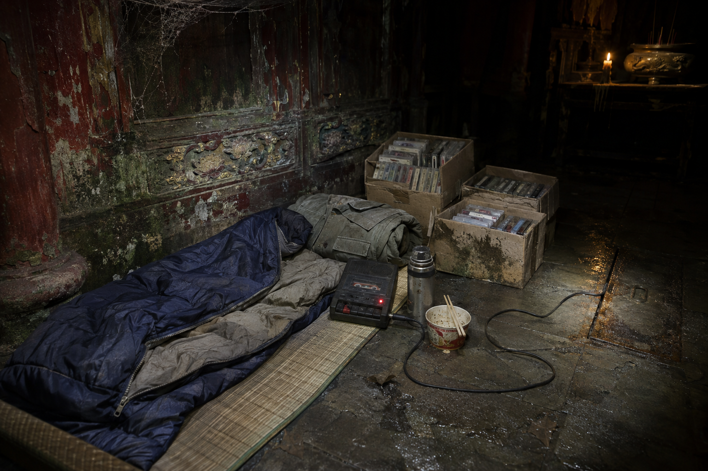

### 18｜郭師父的問者名冊

- 章節：第四章
- 對應取得點：`NOTES.register`
- 資產ID：`note-register`
- 遊戲圖片：`assets/story/visual-v2/note-register.webp`

> 亡者那一格空著。『還』那一格，寫的是她自己。

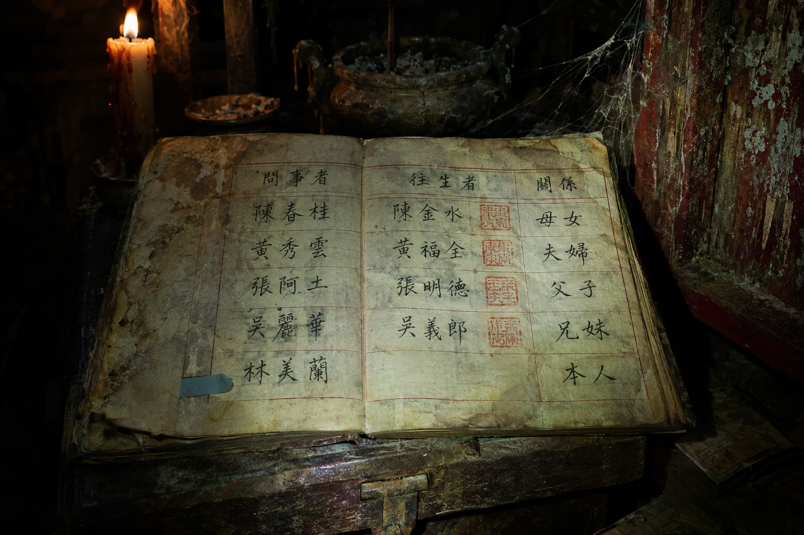

### 19｜燒黑的鐵桶

- 章節：第四章
- 對應取得點：`NOTES.bucket`
- 資產ID：`note-bucket`
- 遊戲圖片：`assets/story/visual-v2/note-bucket.webp`

> 二十八尊都還了。它一尊都沒有收。

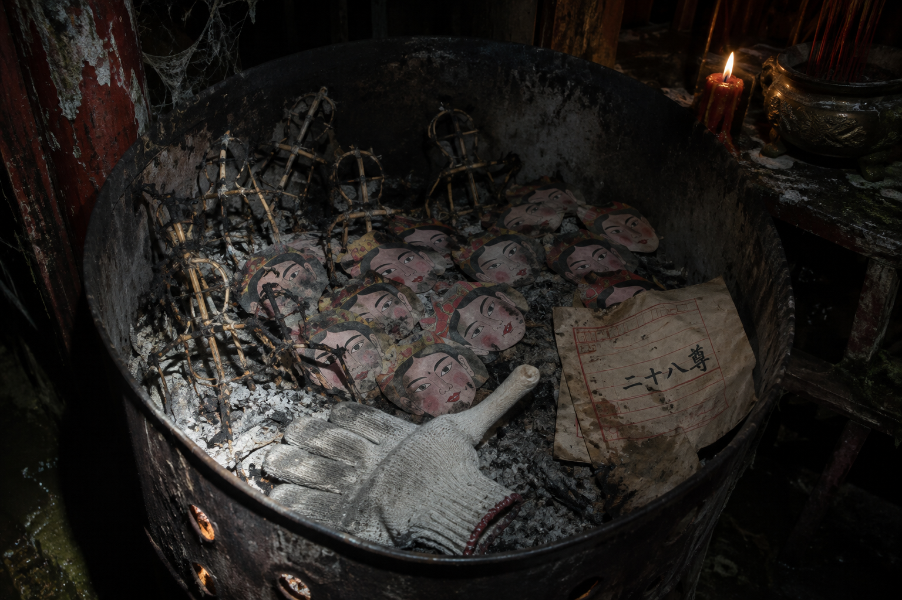

### 20｜門前的一雙女鞋

- 章節：第四章
- 對應取得點：`NOTES.shoes`
- 資產ID：`note-shoes`
- 遊戲圖片：`assets/story/visual-v2/note-shoes.webp`

> 這一次，她自己剪了線。

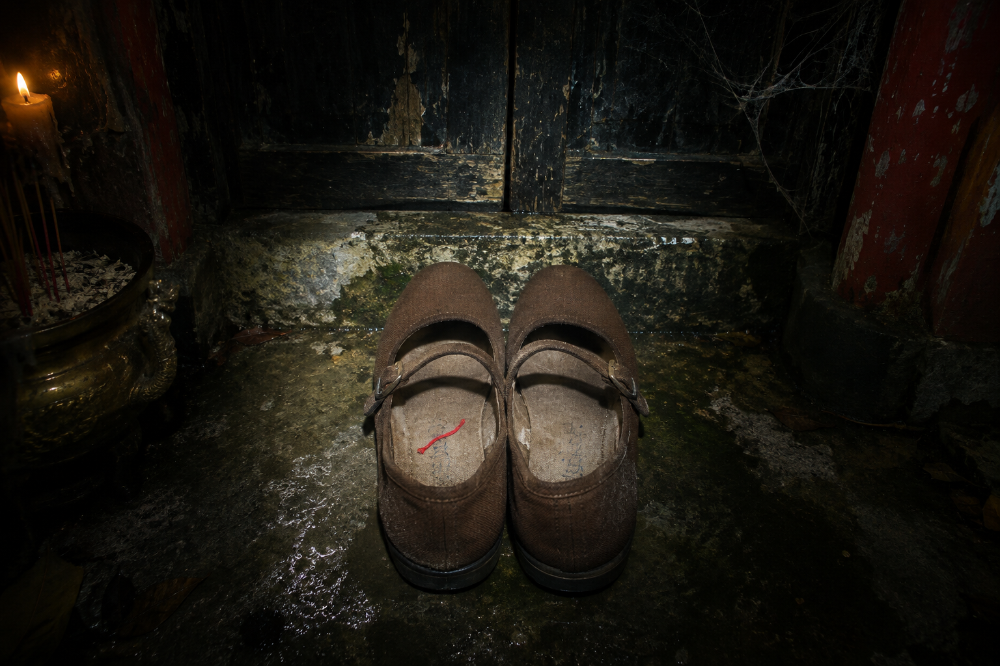

### 21｜阿哲寄回的照片

- 章節：住處序章
- 對應取得點：`Home.letter`
- 資產ID：`home-letter`
- 遊戲圖片：`assets/story/visual-v2/home-letter.webp`

> 照片先還你。02:47，聽到這裡再停。

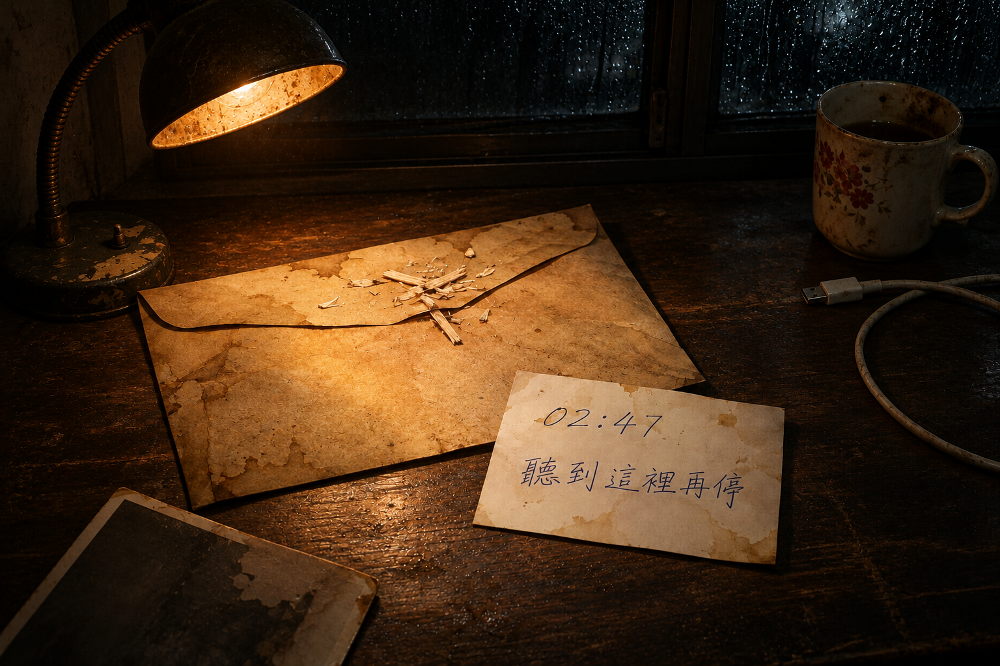

### 22｜退回來的封口

- 章節：住處序章
- 對應取得點：`Home.slip`
- 資產ID：`home-slip`
- 遊戲圖片：`assets/story/visual-v2/home-slip.webp`

> 同一道撕口。它怎麼拿到門外的？

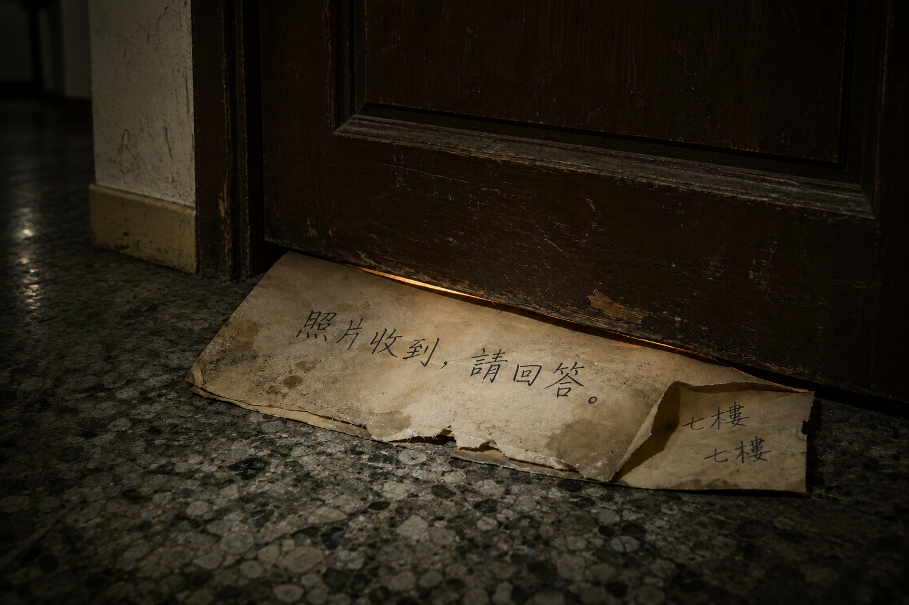

### 23｜有人替我留了位子

- 章節：山村序章
- 對應取得點：`Road.bus`
- 資產ID：`road-bus`
- 遊戲圖片：`assets/story/visual-v2/road-bus.webp`

> 整張椅子都濕了。只有這個位子是乾的。

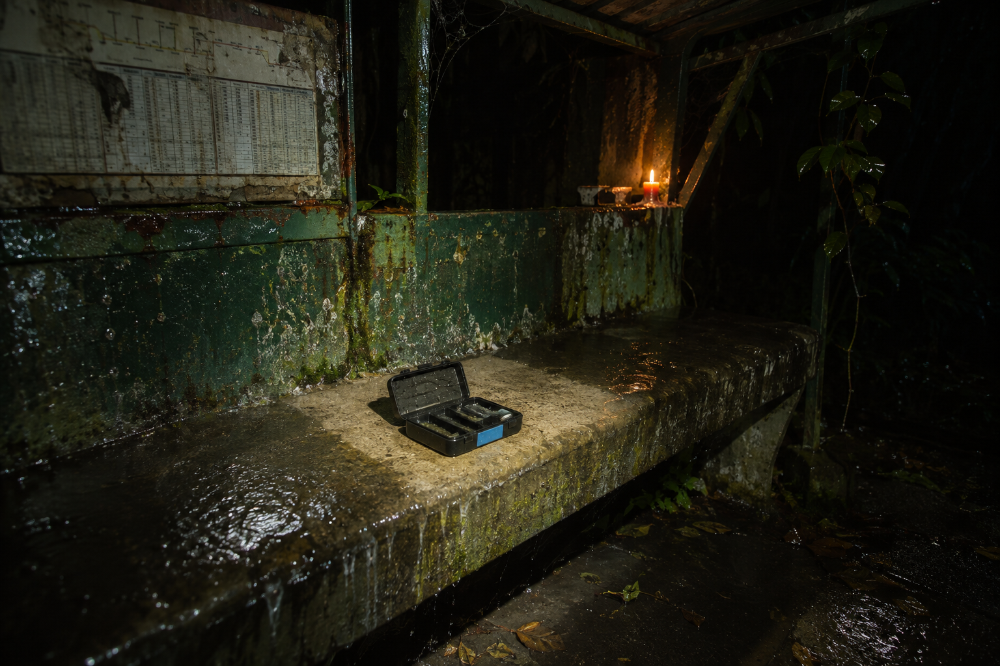

### 24｜整條街都搬走了

- 章節：山村序章
- 對應取得點：`Road.notice`
- 資產ID：`road-notice`
- 遊戲圖片：`assets/story/visual-v2/road-notice.webp`

> 電話打不通。作坊的燈卻還亮著。

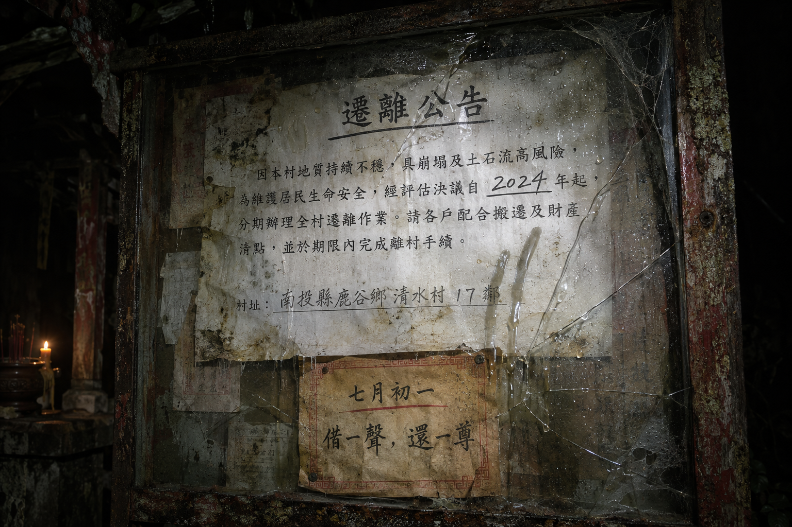

### 25｜還沒完成的手

- 章節：山村序章
- 對應取得點：`Road.remains`
- 資產ID：`road-remains`
- 遊戲圖片：`assets/story/visual-v2/road-remains.webp`

> 關節裡的纖維，像皮，也像泡過水的紙。

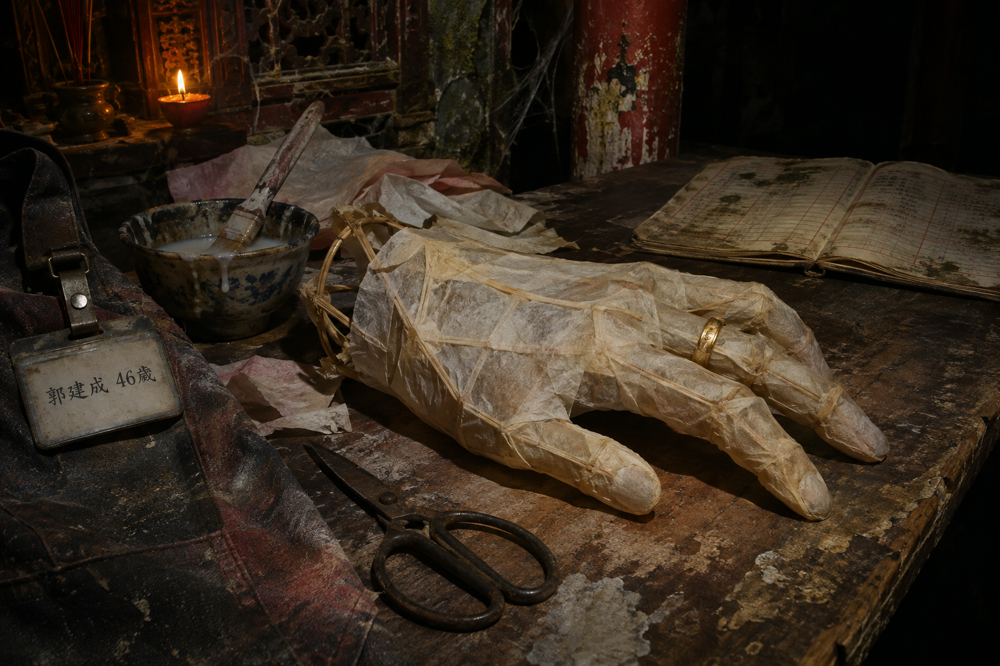

### 26｜十三秒的空畫面

- 章節：山村序章
- 對應取得點：`Road.ledger`
- 資產ID：`road-camera`
- 遊戲圖片：`assets/story/visual-v2/road-camera.webp`

> 第七秒，有一隻手搭上桌沿。他沒有回頭。

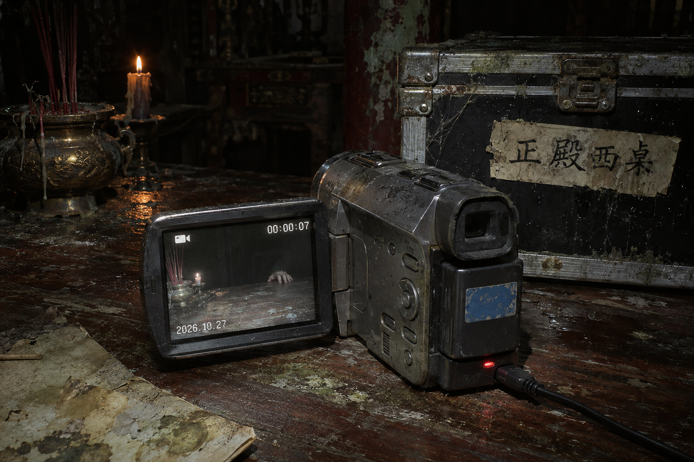

### 27｜沒有燒完的東西

- 章節：山村序章
- 對應取得點：`Road.kiln`
- 資產ID：`road-kiln`
- 遊戲圖片：`assets/story/visual-v2/road-kiln.webp`

> 紙人不會有牙。

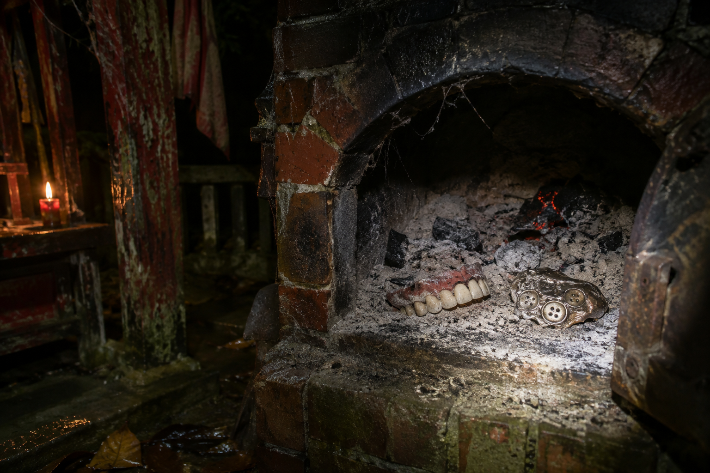

### 28｜車上的時鐘

- 章節：山村序章
- 對應取得點：`Road.car`
- 資產ID：`road-car`
- 遊戲圖片：`assets/story/visual-v2/road-car.webp`

> 這一路，我是一個人開上來的。

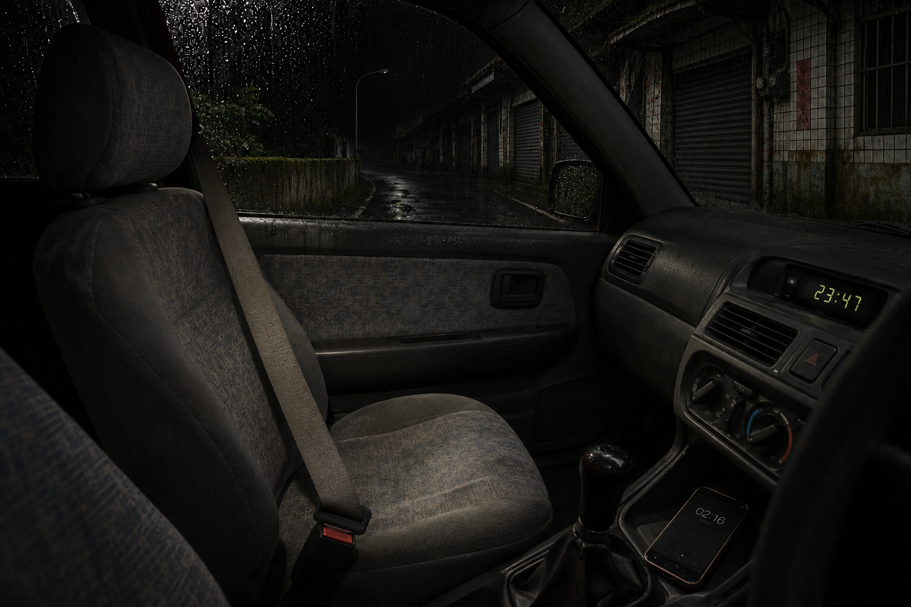

### 29｜停在十二日的月曆

- 章節：住處序章
- 對應取得點：`Home.calendar`
- 資產ID：`home-calendar`
- 遊戲圖片：`assets/story/visual-v2/home-calendar.webp`

> 筆尖壓破了紙。牆上卻沒有痕跡。

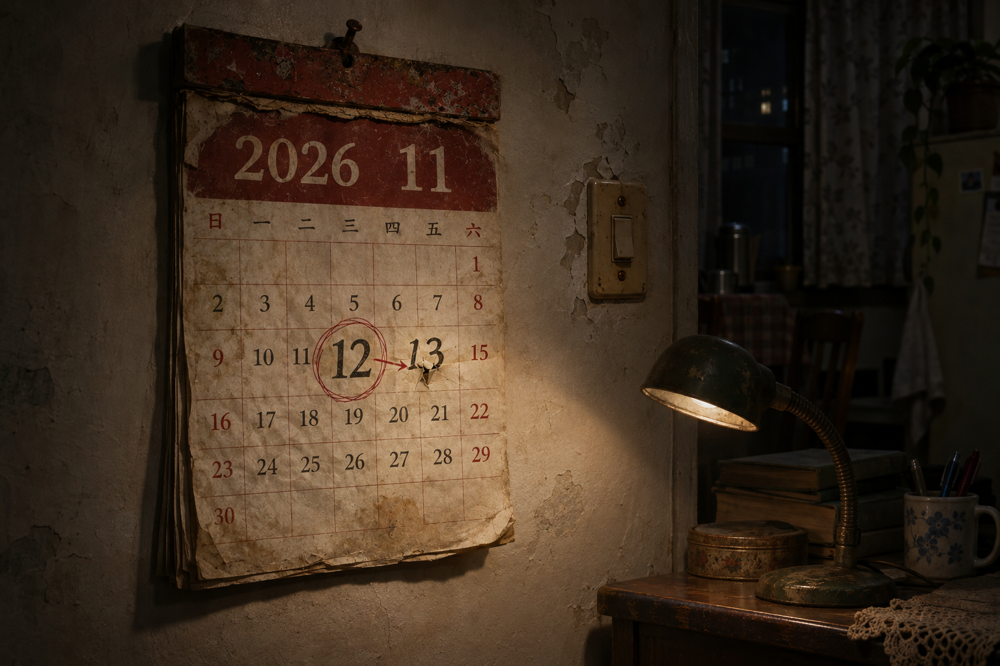

### 30｜雨聲裡少了一拍

- 章節：住處序章
- 對應取得點：`Home.window`
- 資產ID：`home-window`
- 遊戲圖片：`assets/story/visual-v2/home-window.webp`

> 我停住，那聲音也停。這裡是七樓。

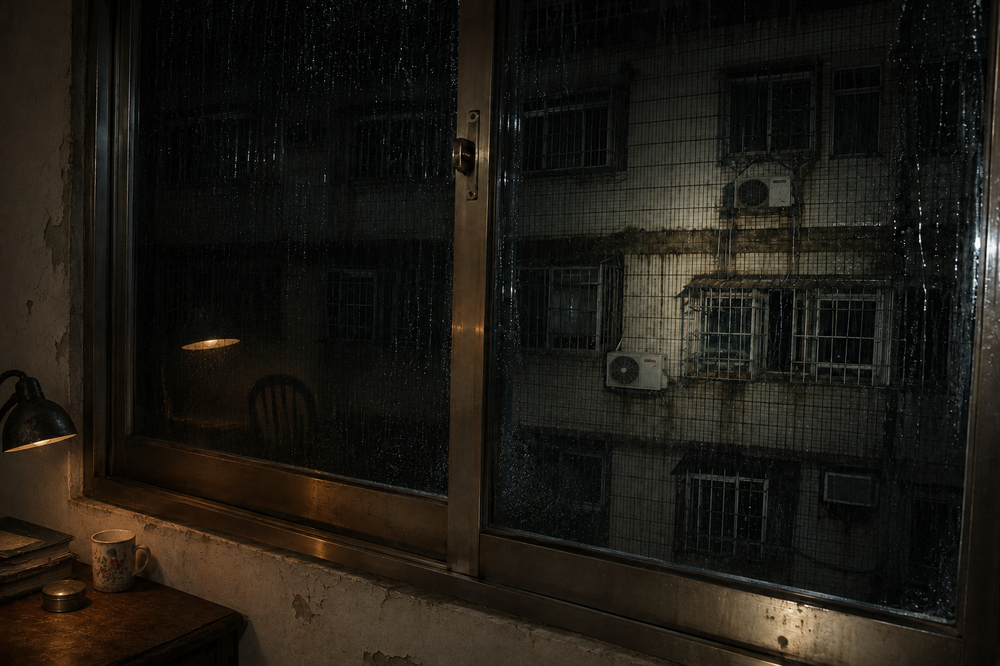

### 31｜沒有送出的語音

- 章節：住處序章
- 對應取得點：`Home.message`
- 資產ID：`home-message`
- 遊戲圖片：`assets/story/visual-v2/home-message.webp`

> 第二段最後的拖椅聲，原本不在那裡。

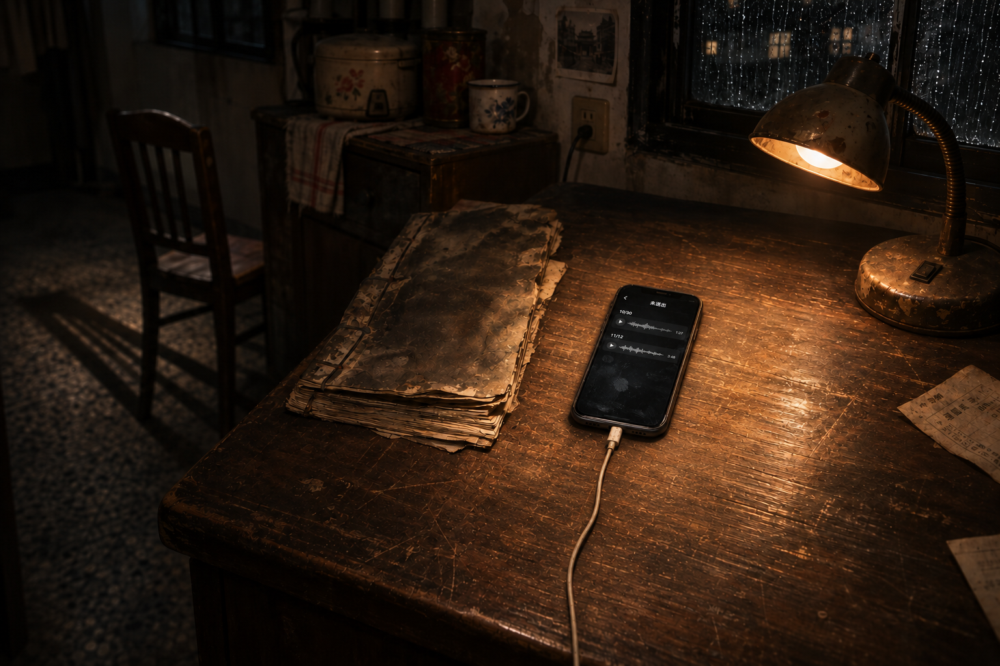

### 32｜天公爐上的刻字

- 章節：第一章
- 對應取得點：`Temple.rules`
- 資產ID：`temple-rules`
- 遊戲圖片：`assets/story/visual-v2/temple-rules.webp`

> 問路可，勿報己名。

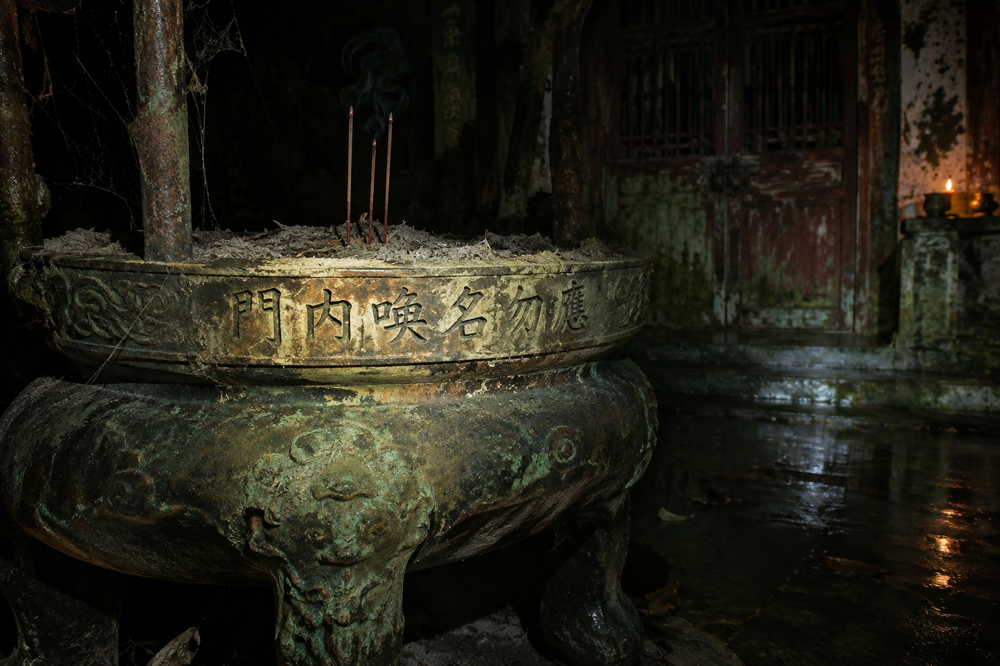

### 33｜暗道邊的三雙鞋

- 章節：第四章
- 對應取得點：`Story.descent`
- 資產ID：`three-friends-shoes`
- 遊戲圖片：`assets/story/visual-v2/three-friends-shoes.webp`

> 阿哲、志豪、柏翰。我的鞋還穿在腳上。

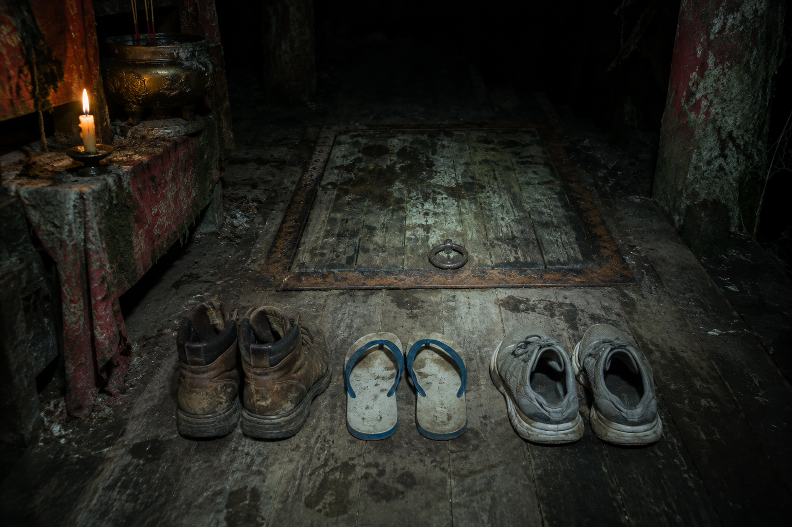

## 關鍵劇情靜幀

### 01｜敲三下

住處序章。顯示條件：接聽完電話，門外自稱管理員時。

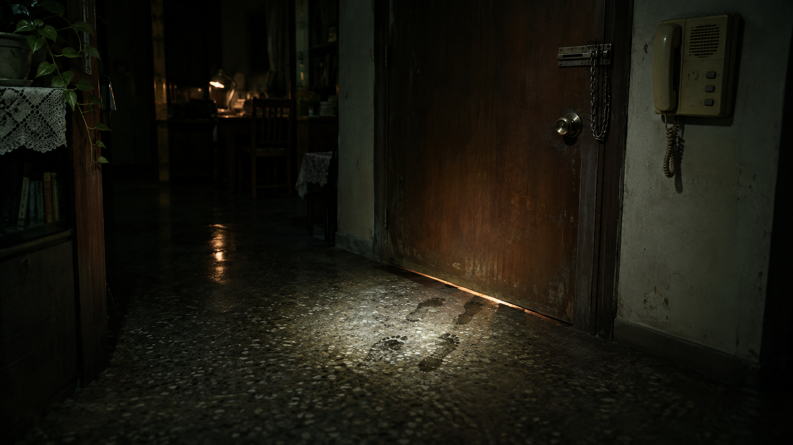

> **門外：**「管理員。剛才送錯東西了，請開一下門。」
>
> **以安・旁白：**「對講機沒有亮過。」

資產ID：`beat-home-door`；圖片：`assets/story/visual-v2/beat-home-door.webp`。

### 02｜停在同一分鐘

第一章。顯示條件：第一次點香、山門關上。

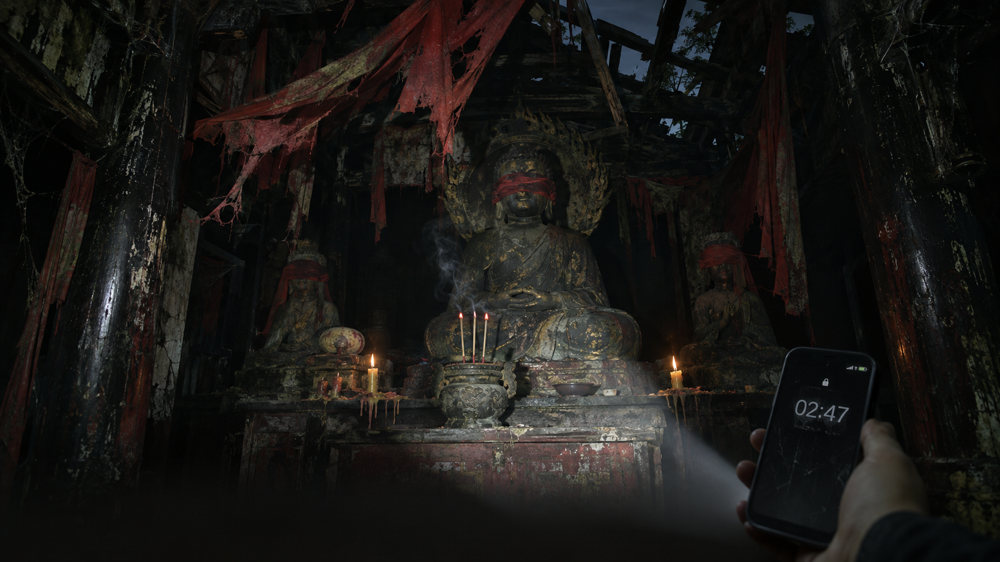

> **以安：**「手機上的時間還是02:47。」
>
> **以安・旁白：**「我進山門，早就不只一分鐘了。」

資產ID：`beat-temple-arrival`；圖片：`assets/story/visual-v2/beat-temple-arrival.webp`。

### 03｜替她喊的那一聲

第三章。顯示條件：戲台第一次記憶重演；不能在序章播放。

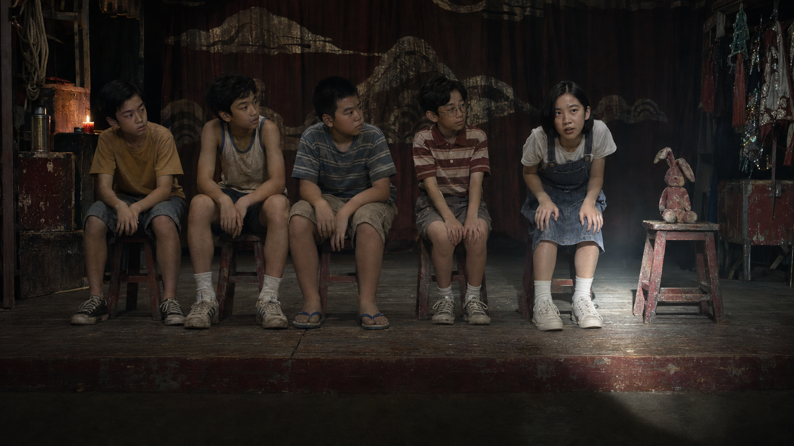

> **點名的人：**「……六。」
>
> **佩珊（童年）：**「有。」
>
> **以安・旁白：**「聲音，是從第五張椅子傳來的。」

資產ID：`beat-rollcall`；圖片：`assets/story/visual-v2/beat-rollcall.webp`。

### 04｜它替他送完了

第三章末。顯示條件：擲筊拿到鑰匙後；不先展示阿哲下落。

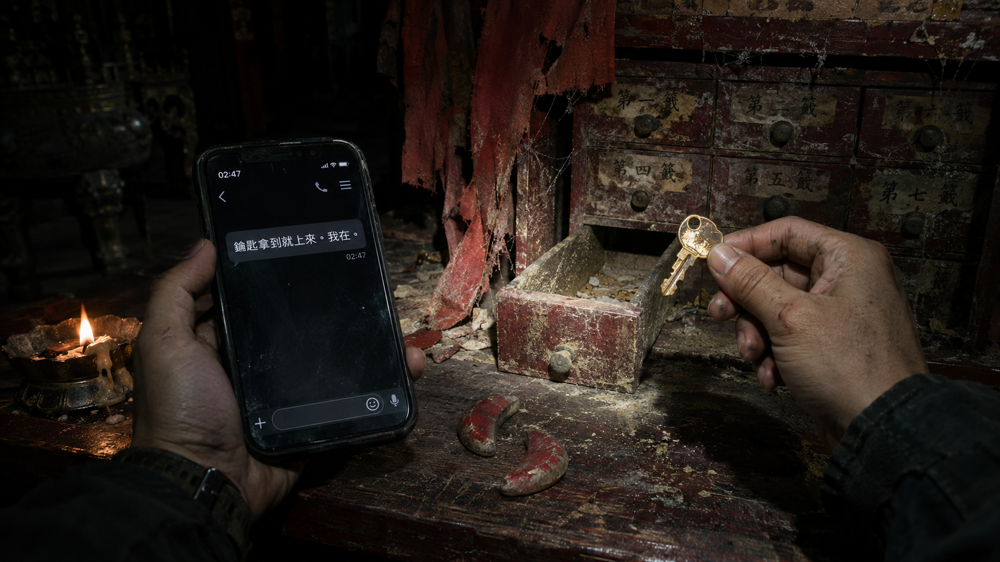

> **手機訊息・阿哲：**「鑰匙拿到就上來。我在。」
>
> **以安・旁白：**「送出時間，還是02:47。」

資產ID：`beat-phone-draft`；圖片：`assets/story/visual-v2/beat-phone-draft.webp`。

### 05｜還：本人

第四章支線。顯示條件：讀過問者名冊與翻過去的木牌後。

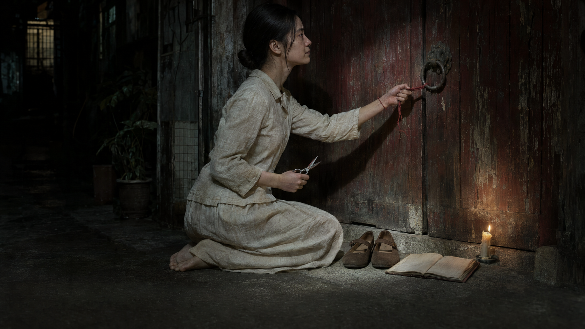

> **林美蘭・旁白：**「這一次不問妳爸爸，問妳。」
>
> **林美蘭：**「這次妳叫，媽媽就應。」

資產ID：`beat-meilan-return`；圖片：`assets/story/visual-v2/beat-meilan-return.webp`。

### 06｜錄音機還在點名

第四章。顯示條件：四樓錄音機演出：阿哲應聲那一刻。

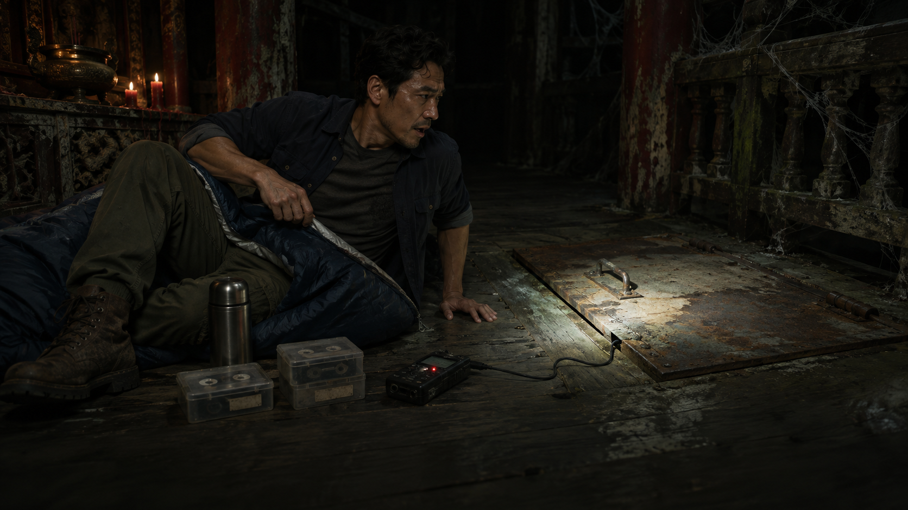

> **錄音裡的女孩：**「張明哲。」
>
> **阿哲：**「……有。」
>
> **以安・旁白：**「帶子早就轉到底了。」

資產ID：`beat-camp-call`；圖片：`assets/story/visual-v2/beat-camp-call.webp`。

### 07｜這次不要替她喊

真結局C。顯示條件：歸物後六張椅子出現。

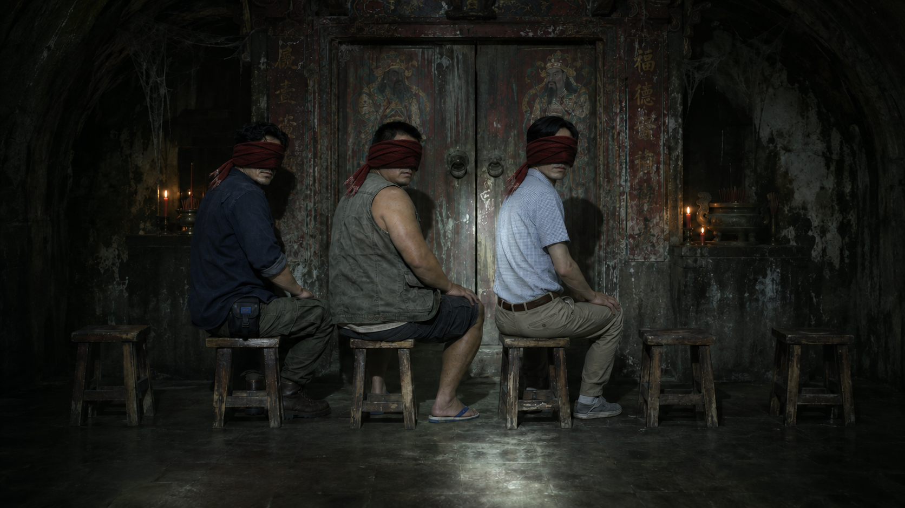

> **錄音：**「……六。」
>
> **以安・旁白：**「這一次，我等她自己回答。」

資產ID：`beat-six-seats`；圖片：`assets/story/visual-v2/beat-six-seats.webp`。

### 08｜這次不要放手

第四章真相／真結局C。顯示條件：舊鎖真相後，見證轉鑰匙時。

> **以安：**「我是陳以安。門是我扣的。」
>
> **門內・小雨：**「你說你會回來。」

資產ID：`beat-key-fire`；圖片：`assets/story/visual-v2/beat-key-fire.webp`。

### 09｜你回來了

真結局C。顯示條件：成功轉開鎖，門開之後。

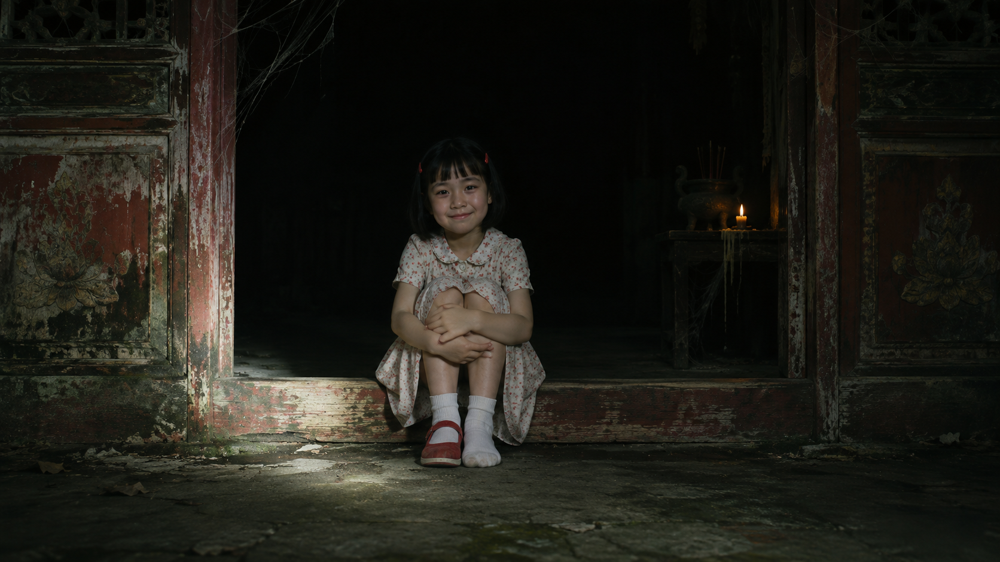

> **小雨：**「你回來了。」
>
> **以安：**「對不起。我說我等一下就回來。」

資產ID：`beat-child-threshold`；圖片：`assets/story/visual-v2/beat-child-threshold.webp`。

### 10｜這次媽媽有應

真結局C。顯示條件：美蘭恢復自己的聲音；重逢。

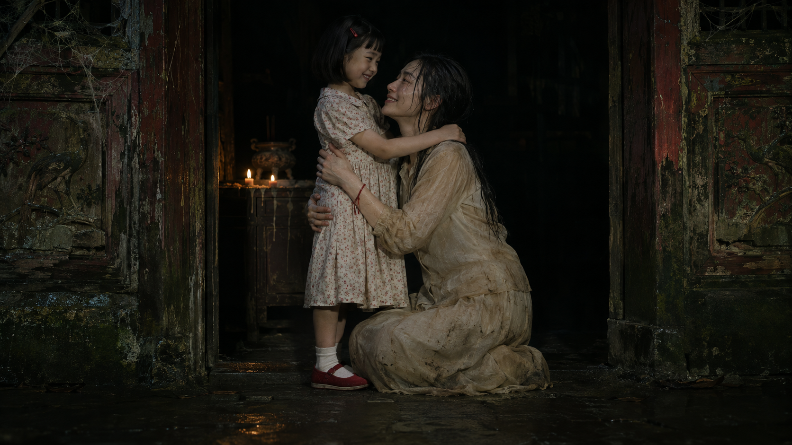

> **林美蘭：**「……小雨？」
>
> **小雨：**「媽媽。」

資產ID：`beat-mother-daughter`；圖片：`assets/story/visual-v2/beat-mother-daughter.webp`。

### 11｜又說了一次

結局A。顯示條件：離寺後的幾個月，自己的來電。

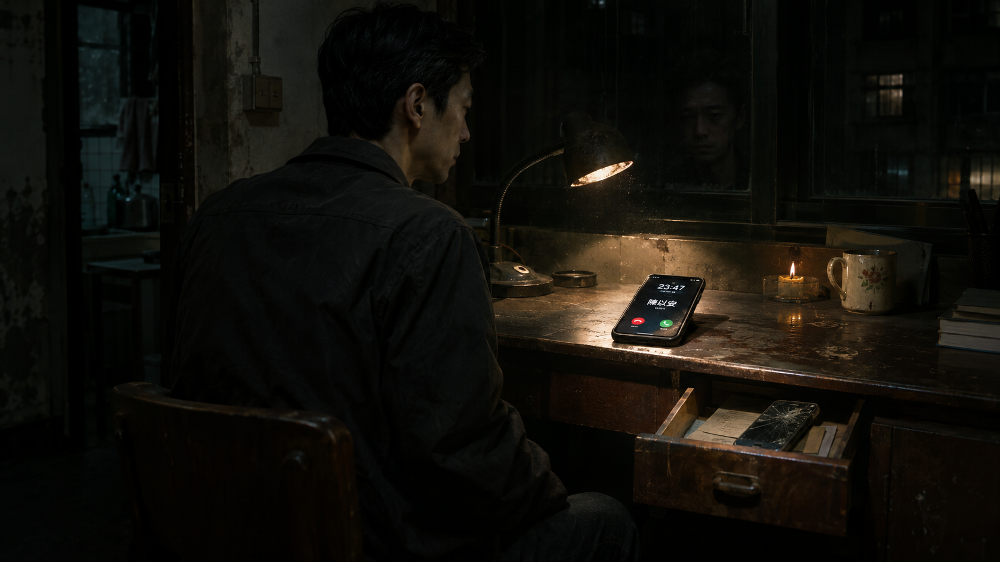

> **自己的聲音：**「裡面還有沒有人？」
>
> **以安・旁白：**「這一次，沒有大人教我。」

資產ID：`beat-ending-a`；圖片：`assets/story/visual-v2/beat-ending-a.webp`。

### 12｜換妳了

結局B。顯示條件：替身拿起手機離開，主角留在第六張椅子。

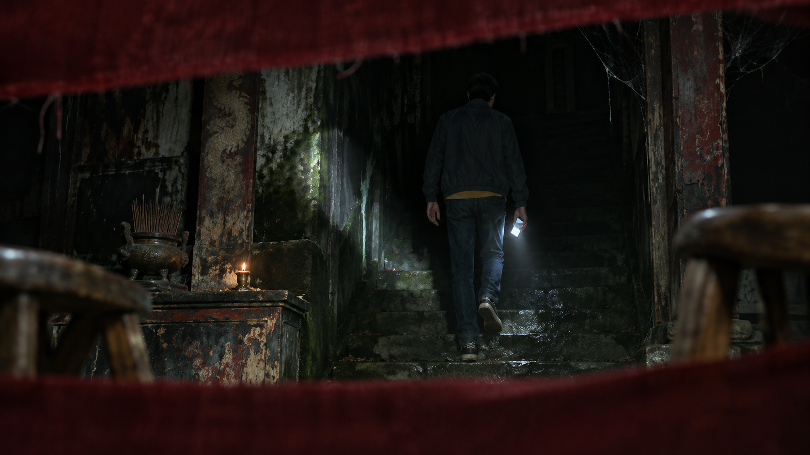

> **替身：**「佩珊，是我。」
>
> **替身：**「我出來了。換妳了。」

資產ID：`beat-ending-b`；圖片：`assets/story/visual-v2/beat-ending-b.webp`。

### 13｜裡面還有人

結局C。顯示條件：黎明救援，最後回答有。

> **搜救隊：**「裡面還有沒有人？」
>
> **以安：**「有。地下，神壇後面那扇門。」
>
> **阿哲：**「……小雨。」

資產ID：`beat-ending-c`；圖片：`assets/story/visual-v2/beat-ending-c.webp`。

## 連續性與製作限制

三位朋友仍活著，不能用屍體圖暗示死亡。郭建成的紙手線索不確定他的生死。門口小雨只有右腳穿紅鞋；遺物裡是被藏走的另一隻。美蘭紅線在左腕、兔子修補自身左耳；以安掌心疤在右手。最後開門不展示兒童燒傷，以成人握住熱鑰匙、門縫與火光表達。

所有生成原稿及提示詞列於 [manifest.json](../art-direction/visual-bible-20261120/manifest.json)。[開啟圖冊](../art-direction/visual-bible-20261120/index.html) 可按類別、章節、關鍵字查看並放大。每張 PNG 旁的同名 JSON 保存提示詞和角色參考，後續修圖應由原稿繼續編修，避免重新抽換人物。
